# Lab 1: Active Directory – Domain Build and PowerShell Joiner/Mover/Leaver

> **Goal:** Build Edao Logistics' on-premises identity foundation from scratch: a Windows Server domain controller, a clean OU and group structure, and PowerShell scripts that run the full **joiner → mover → leaver** lifecycle with least privilege and an audit log.

**Platforms:** Windows Server 2025 (evaluation) on Oracle VirtualBox · Active Directory Domain Services · DNS · **Language:** PowerShell (ActiveDirectory module) · **Domain:** `corp.edaologistics.local` (NetBIOS `CORP`)

---

## Results at a glance

| Test | Expected | Result | Evidence |
| --- | --- | --- | --- |
| Domain controller built | New forest, AD DS + DNS | ✅ `DC01` promoted, sign-in as `CORP\Administrator` | [Step 2](#2-build-the-domain-controller) |
| Structure as code | OUs and groups created by script | ✅ 10 OUs, 5 department security groups | [Step 3](#3-ou-and-group-structure) |
| **Joiner** | 6 new hires from an HR CSV | ✅ Accounts created in the right OU and group, temporary password, change at first sign-in | [Step 4](#4-joiner) |
| **Mover** | Operations → Sales | ✅ Old access removed **first**, then OU, title and new group updated | [Step 5](#5-mover) |
| **Leaver** | Departing employee locked out | ✅ Disabled, password scrambled, all groups removed, ticket stamped, moved to Disabled Users | [Step 6](#6-leaver) |
| Audit trail | Every change logged | ✅ 12 timestamped entries in `lifecycle_log.csv` | [Audit log](#audit-log) |

---

## Architecture

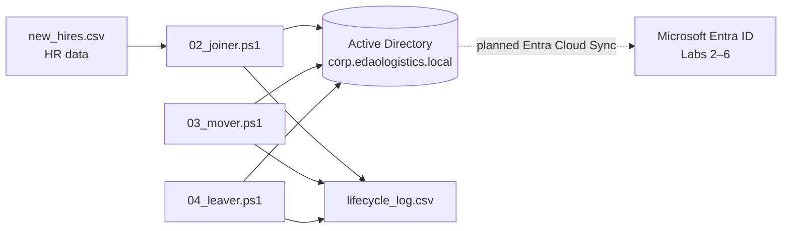

**OU and group design**

```
corp.edaologistics.local
└── Edao
    ├── Users
    │   ├── Finance · HR · IT · Operations · Sales     ← one OU per department
    ├── Groups            AD-Finance · AD-HR · AD-IT · AD-Operations · AD-Sales
    ├── Disabled Users    ← leavers land here, out of every group
    └── Service Accounts  ← kept separate from people
```

Company objects live under one **Edao** OU instead of the default `Users` container, so Group Policy, delegation and a future sync scope can target them cleanly. Access is granted through **department groups**, never directly to a person.

---

## 1. Build the virtual machine

I created the VM in VirtualBox with 2 CPUs, a 50 GB dynamically allocated disk and the Windows Server 2025 evaluation ISO. I turned **unattended installation off**, so I could choose the *Desktop Experience* edition and set my own Administrator password.

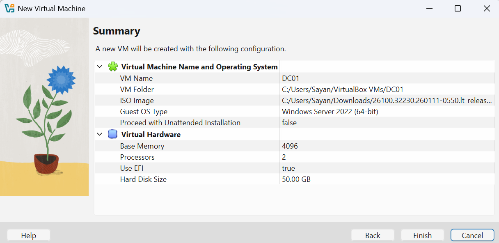

I later lowered memory from 4 GB to 3 GB and turned off EFI. See [What went wrong](#what-went-wrong-and-how-i-fixed-it).

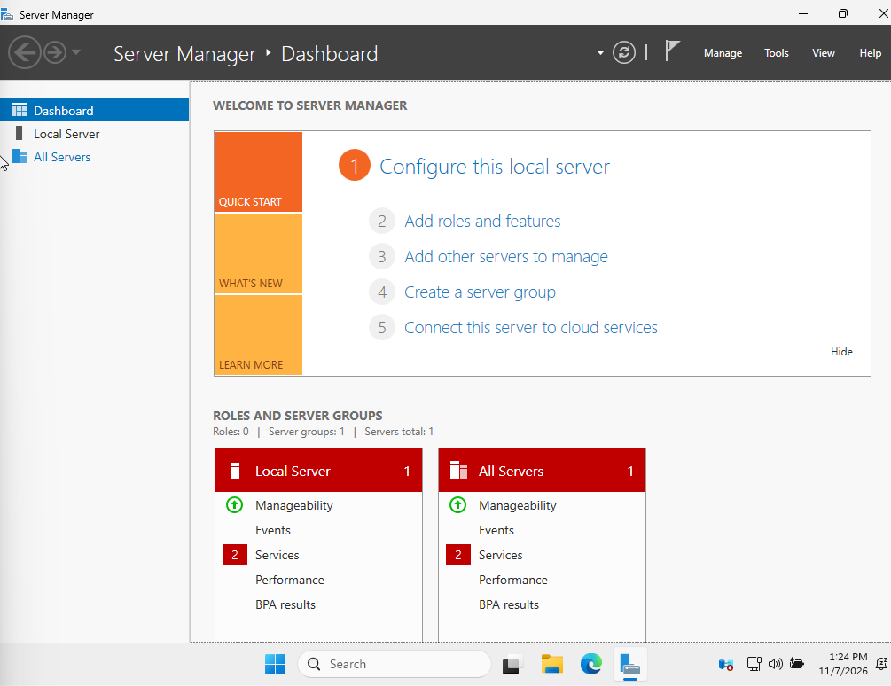

## 2. Build the domain controller

**Prepare the server:** I renamed it to `DC01`, set the Eastern time zone, and set a **static IP** (10.0.2.15). A domain controller needs a fixed address, because every domain member finds it through DNS.

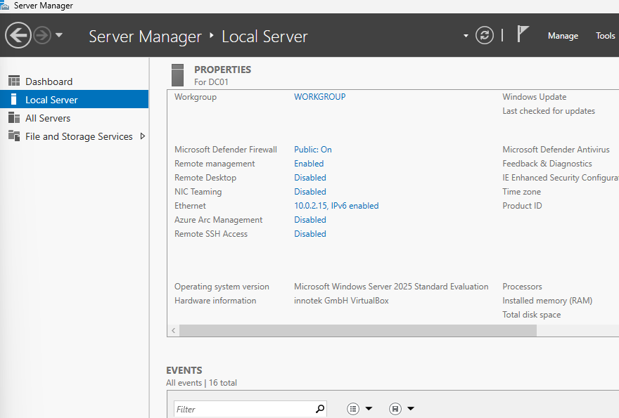

**Install AD DS** with Server Manager's Add Roles and Features:

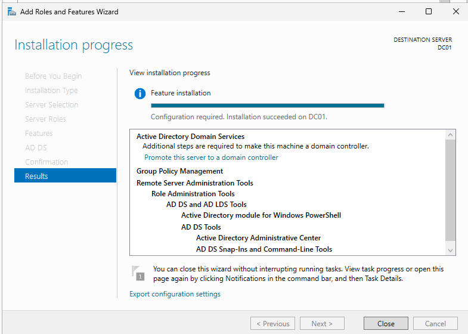

**Promote to a domain controller:** new forest `corp.edaologistics.local`, with DNS and Global Catalog, plus a separate **DSRM** (Directory Services Restore Mode) recovery password. The DNS delegation warning is expected for a new forest with no parent zone.

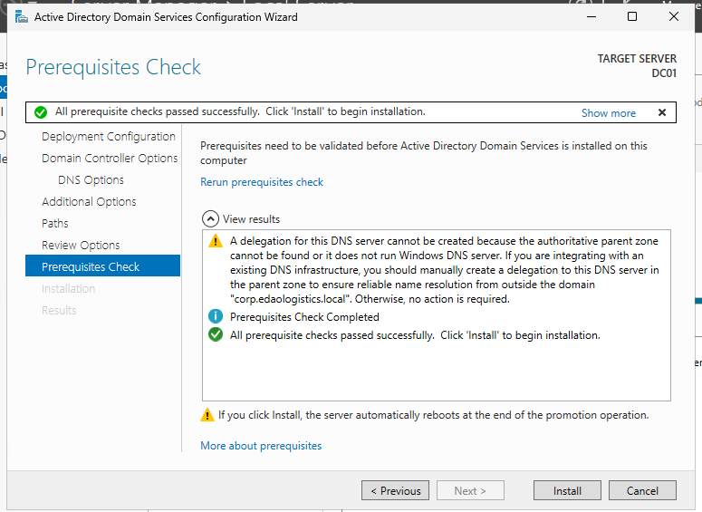

After the automatic restart, the sign-in screen shows the domain account `CORP\Administrator`:

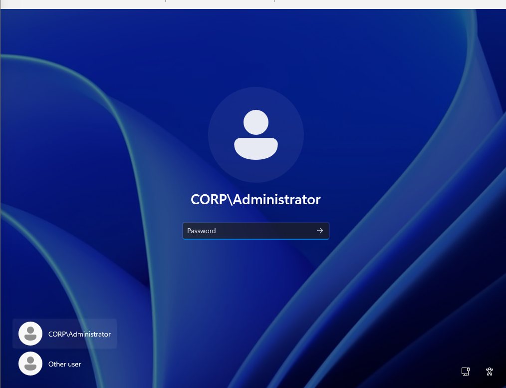

## 3. OU and group structure

[`01_build_structure.ps1`](01_build_structure.ps1) creates the whole structure in one run, so it's repeatable and reviewable instead of clicked together by hand:

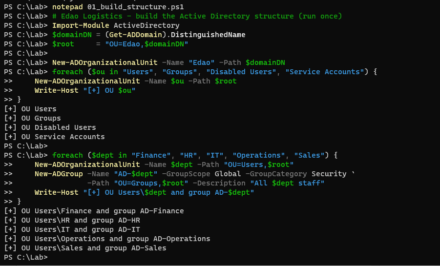
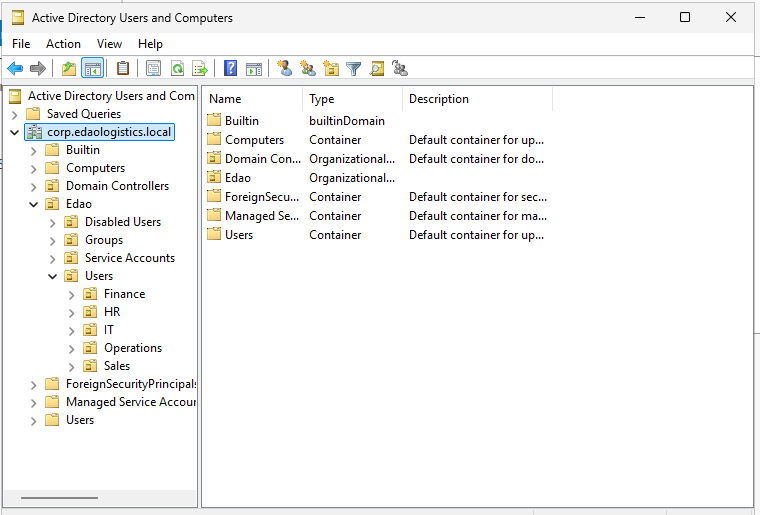

## 4. Joiner

[`02_joiner.ps1`](02_joiner.ps1) reads [`new_hires.csv`](new_hires.csv), which stands in for an HR export. Each new hire is Edao's on-site warehouse and office staff. For each row, the script:

- Builds a consistent username (`firstname.lastname`) and **skips anyone who already exists**
- Sets first and last name, display name, **employee ID**, department and title
- Places the account in the department's OU and adds it to the matching `AD-<Department>` group
- Sets a temporary password that is **typed in hidden, never saved** and must be changed at first sign-in
- Logs each action

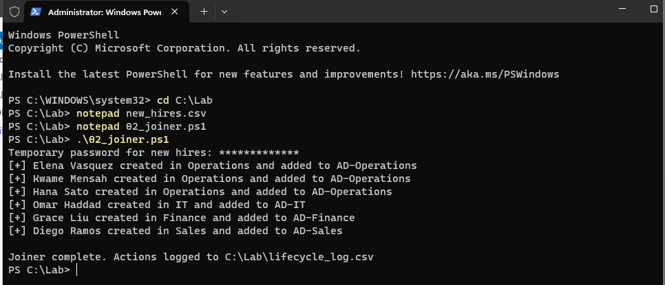

## 5. Mover

**Scenario:** Hana Sato transfers from Operations (Dispatcher) to Sales (Sales Coordinator).

[`03_mover.ps1`](03_mover.ps1) shows the change and asks for confirmation, then works in a deliberate order:

1. **Remove old department access first.** If anything fails later, she ends up with *less* access, never more.
2. Update department and title
3. Move the account to the Sales OU
4. Add her to `AD-Sales`

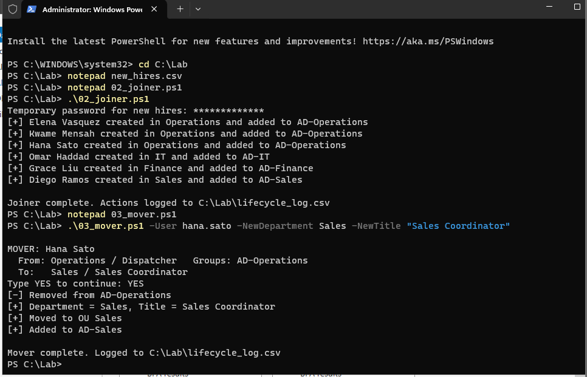

The Operations OU now holds only Elena and Kwame:

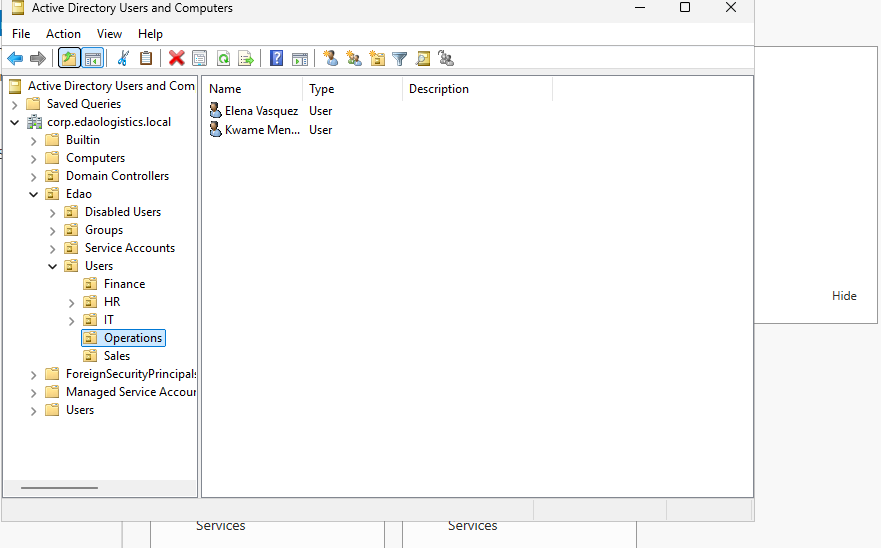

This is the step the Okta mover handled automatically in [Lab 3](../03-okta/README.md), and the step that was missed for Jordan in [Lab 6](../06-governance/README.md). Here it's an explicit, logged process.

## 6. Leaver

**Scenario:** Kwame Mensah (Warehouse Supervisor) leaves the company under ticket **HR-1042**.

[`04_leaver.ps1`](04_leaver.ps1):

| Step | Why |
| --- | --- |
| Disable the account | Stops new sign-ins immediately |
| Reset the password to a random 32-character value that isn't stored | Even someone who knew the old password, or who re-enables the account by mistake, can't use it |
| Remove every group membership | No lingering access if the account is ever re-enabled |
| Stamp the description: `Disabled 2026-11-07 - HR-1042 - former Operations Warehouse Supervisor` | An auditor can see who, when and why without searching ticket systems |
| Move to **Disabled Users** | Leavers are separated from active staff and easy to review or delete after retention |

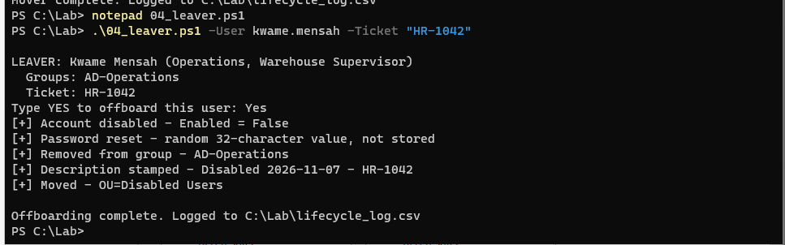
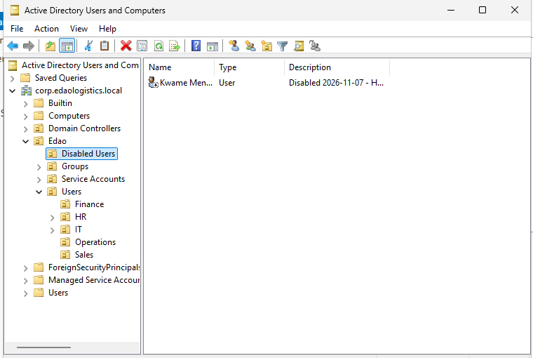

I kept the account (disabled) instead of deleting it. Deleting immediately would lose the group history and the object's audit trail. A retention period followed by deletion is the safer process.

## Audit log

Every script appends to `C:\Lab\lifecycle_log.csv`:

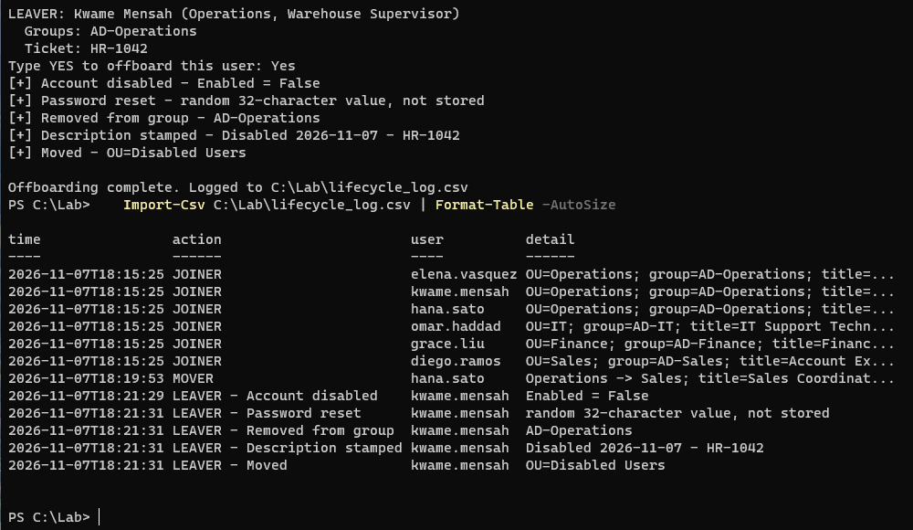

| Time (Nov 7, 2026) | Action | User |
| --- | --- | --- |
| 18:15:25 | JOINER ×6 | elena.vasquez, kwame.mensah, hana.sato, omar.haddad, grace.liu, diego.ramos |
| 18:19:53 | MOVER: Operations → Sales | hana.sato |
| 18:21:29 – 18:21:31 | LEAVER: disabled, password reset, removed from AD-Operations, description stamped, moved | kwame.mensah |

---

## Security decisions

- **Least privilege by group.** Access is granted through `AD-<Department>` groups, never to individuals.
- **Remove before add.** The mover takes away old access before granting new access.
- **No passwords in files.** The joiner's temporary password is read with `-AsSecureString`, and the leaver's random password is never displayed or saved.
- **Forced password change** at first sign-in for every new hire.
- **Confirmation before destructive changes.** Mover and leaver show exactly what will change and require typing `YES`.
- **Separate OUs for disabled users and service accounts**, so policies and reviews can target them.
- **Separate recovery credential.** The DSRM password is stored apart from the Administrator password.

## What went wrong and how I fixed it

- **The laptop froze and I lost my mouse.** I clicked "don't capture" on VirtualBox's mouse-capture message, and the VM kept the keyboard and mouse. The release key was **Right Ctrl**, which my laptop doesn't have. `Ctrl+Alt+Delete` (which Windows always handles) got me to Task Manager to end VirtualBox. Then I changed VirtualBox's host key to **Left Ctrl + Left Alt**.
- **Not enough memory.** The host had only 3.4 GB of RAM free, and the VM was set to use 4 GB. I closed other apps and lowered the VM to **3 GB**, which still runs Windows Server with Desktop Experience fine for a lab.

  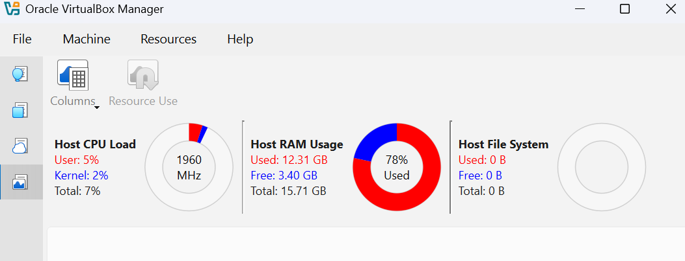

- **Black screen, nothing booting.** With EFI enabled, the VM stayed on a black screen even with the install ISO attached. Turning **EFI off** and tapping the Spacebar right at startup launched Windows Setup.

  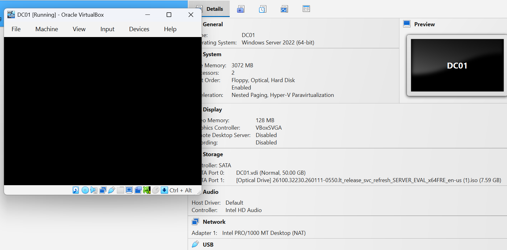

- **A static IP that wasn't.** `New-NetIPAddress` failed with "already exists," because VirtualBox's DHCP had already assigned that address. I set it as static in the network adapter's IPv4 settings instead.
- **Stuck on "Restarting."** The first restart after renaming hung for over 10 minutes. I ejected the install ISO and reset the VM, and the rename applied on the next boot.
- **A pasted script ran line by line.** I pasted the structure script straight into PowerShell instead of saving it to a file first. It still worked, but the last line merged with the next command and showed a harmless parse error. I saved the file afterward so it's in the repo.
- **A confirmation check that wasn't strict.** When I typed `Yes` instead of `YES`, the leaver still ran, because PowerShell's `-ne` is case-insensitive. I switched the mover and leaver to **`-cne`** (case-sensitive), so only an exact `YES` continues.

## What I'd do in production

- **Connect to Entra ID with Entra Cloud Sync**, scoped to `OU=Users,OU=Edao`, so on-premises joiners flow to the cloud and on through SCIM to AWS ([Lab 4](../04-aws/README.md)). Add a routable UPN suffix (for example `edaologistics.com`) first, since `.local` can't be verified in Entra.
- **Two domain controllers** minimum, plus backups of the system state.
- **Tiered admin accounts**: a separate admin account per person instead of the built-in Administrator, and Protected Users for privileged accounts.
- **Fine-grained password policy** and **LAPS** for local admin passwords on member servers and workstations.
- **Group Policy baselines** per OU (for example, screen lock and USB restrictions for Operations workstations).
- **Drive the scripts from the HR system** on a schedule, with the log shipped to a SIEM instead of a local CSV.
- **Delete disabled accounts after a retention period** (for example 30–90 days), with a scheduled report of anything in Disabled Users.

## Files

| File | Purpose |
| --- | --- |
| [`01_build_structure.ps1`](01_build_structure.ps1) | Creates the Edao OU tree and department groups |
| [`new_hires.csv`](new_hires.csv) | Simulated HR export of new hires |
| [`02_joiner.ps1`](02_joiner.ps1) | Creates new hires from the CSV |
| [`03_mover.ps1`](03_mover.ps1) | Transfers an employee between departments |
| [`04_leaver.ps1`](04_leaver.ps1) | Offboards a departing employee |

**Usage**
```powershell
.\01_build_structure.ps1
.\02_joiner.ps1
.\03_mover.ps1 -User hana.sato -NewDepartment Sales -NewTitle "Sales Coordinator"
.\04_leaver.ps1 -User kwame.mensah -Ticket "HR-1042"
```

## Skills demonstrated

Windows Server · Active Directory Domain Services · DNS · Domain controller promotion · OU design · Security groups and RBAC · PowerShell (ActiveDirectory module) · Joiner/mover/leaver automation · Least privilege · Audit logging · VirtualBox virtualization · Troubleshooting
