# Lab 3: Okta Workforce Identity – SSO, MFA and Joiner/Mover/Leaver

> **Goal:** Make Okta the single front door for a company app. Sort users into access groups automatically from HR data, require phishing-resistant MFA, and prove that a new hire, a transfer and a departing employee each end up with exactly the access they should, backed by audit-log evidence.

**Platform:** Okta Integrator Free Plan (Okta Identity Engine) · **Company:** Edao Logistics (fictional) · **Protocol:** OpenID Connect (OIDC)

---

## Results at a glance

| Test | Expected | Result | Evidence |
| --- | --- | --- | --- |
| Finance user signs in to the Finance app | Allowed, with MFA | ✅ Signed ID token issued, `amr: ["phr", "okta_verify"]` | [Step 4](#4-sso-proving-who-gets-in) |
| Sales user signs in to the Finance app | Denied | ✅ `access_denied` – user not assigned | [Step 4](#4-sso-proving-who-gets-in) |
| **Joiner:** new Finance hire | Access on day one, no manual steps | ✅ Added to group and app by Okta automatically | [Step 5](#joiner--nina-park-new-finance-hire) |
| **Mover:** Finance → Sales | New group, old app access removed | ✅ Removed from Finance and the app automatically, then denied | [Step 5](#mover--jordan-ellis-finance--sales) |
| **Leaver:** employee departs | All access ends immediately | ✅ App access removed, sessions cleared, sign-in blocked | [Step 5](#leaver--maya-chen-leaves-the-company) |

---

## Architecture

**How sign-in works (OIDC)**

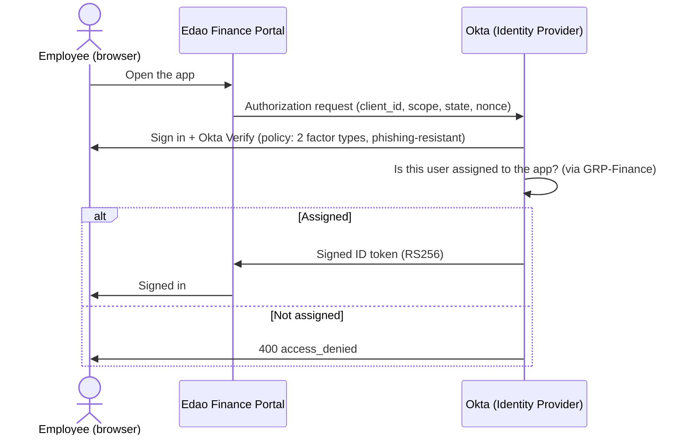

**How access follows HR data (lifecycle)**

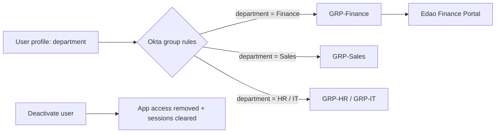

Access is never granted to a person directly. It flows **attribute → group → app**, so changing one field (department) is enough to grant or remove access everywhere.

---

## 1. Org setup

The Okta free developer plan only accepts business email addresses, so I registered my own domain (`bekaedao.com`) and used Cloudflare Email Routing with a **catch-all** rule to receive mail for every test user. This mirrors how a real company domain works and let Okta's activation and verification emails reach me.

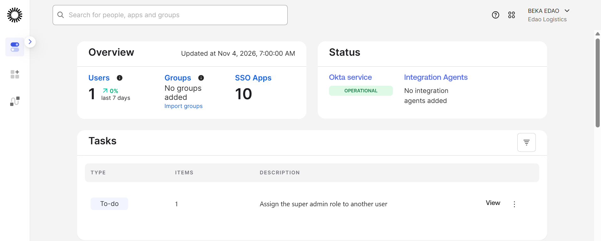

> The dashboard's to-do item, *"Assign the super admin role to another user,"* is Okta flagging that a single super admin is a lockout risk. That's the same reason I built a break-glass account in [Lab 2](../02-entra-id/README.md). See [What I'd do in production](#what-id-do-in-production).

## 2. Users, groups and attribute-based group rules

Created 6 employees with usernames on the company domain and a **department** attribute. Each one received a temporary password and was required to change it at first sign-in (which is why their status shows *Password expired*).

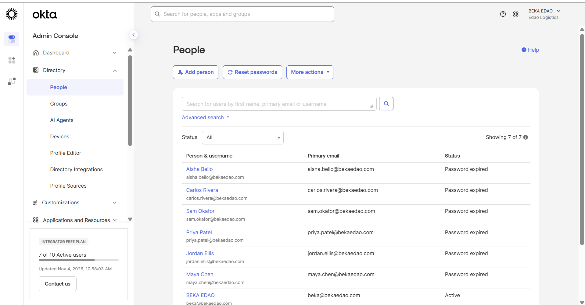
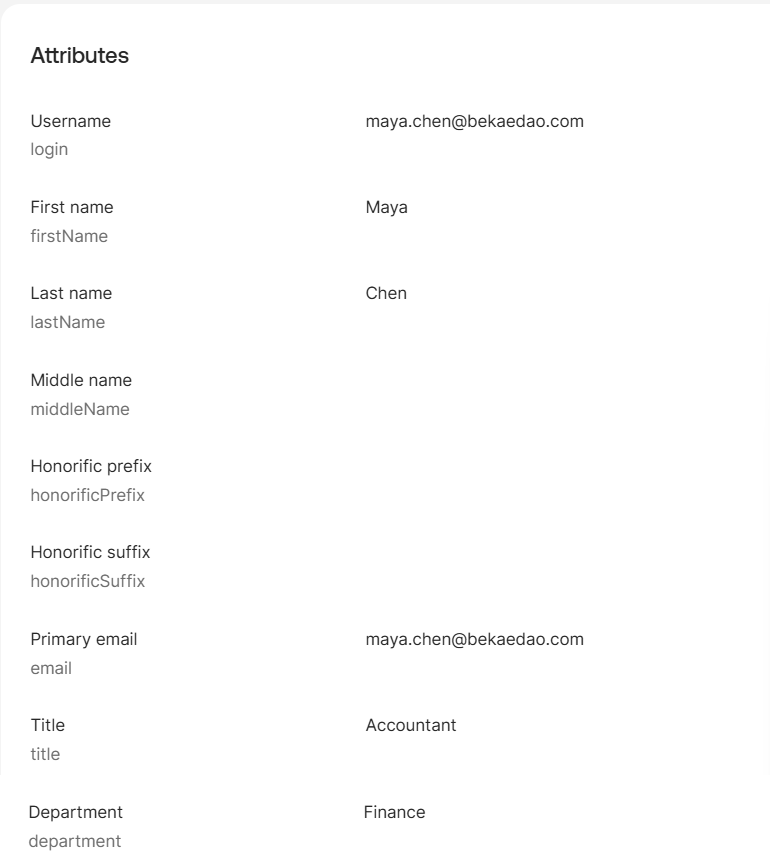

Created four department groups and a **group rule** for each one: *if `user.department` equals Finance, then assign to GRP-Finance*. The rules are what make joiner/mover/leaver automatic.

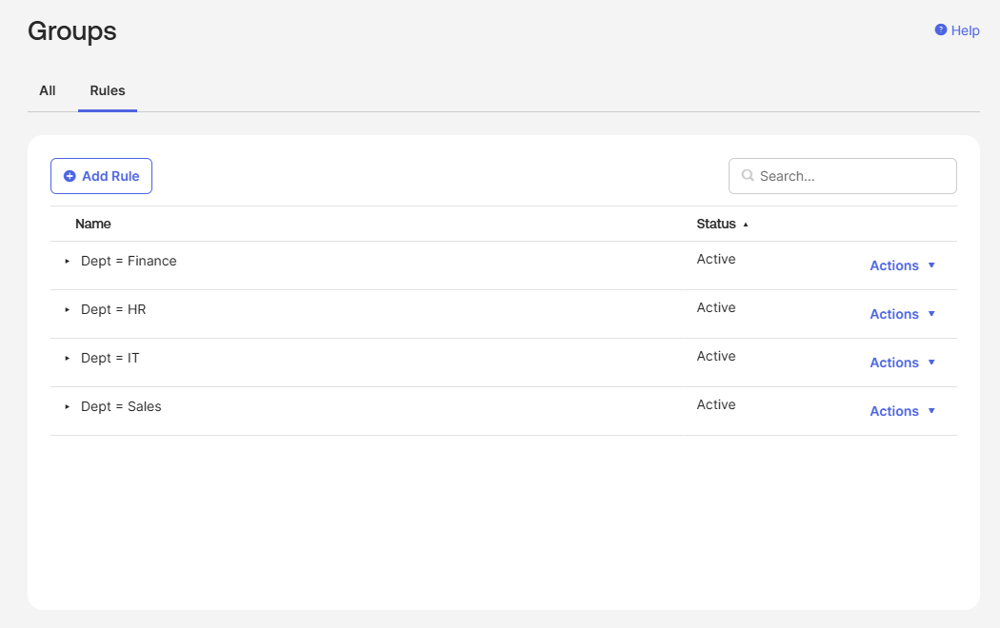

The Managed column confirms that membership comes **from the rule**, not from manual assignment:

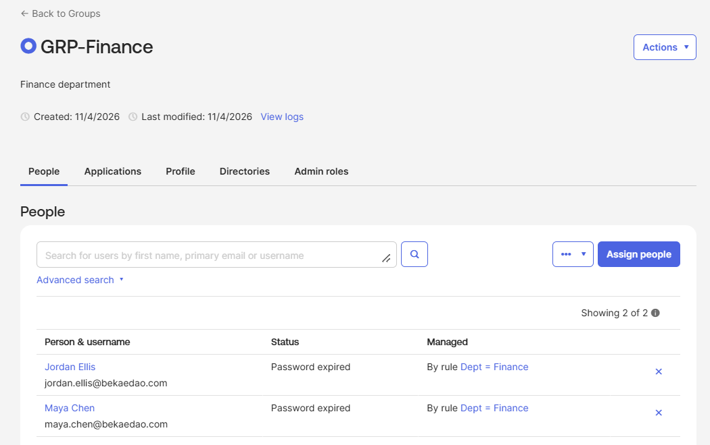

## 3. MFA: enrollment and sign-in policy

**Authenticator enrollment:** Okta Verify is **Required** for everyone, so every user must enroll a second factor the first time they sign in.

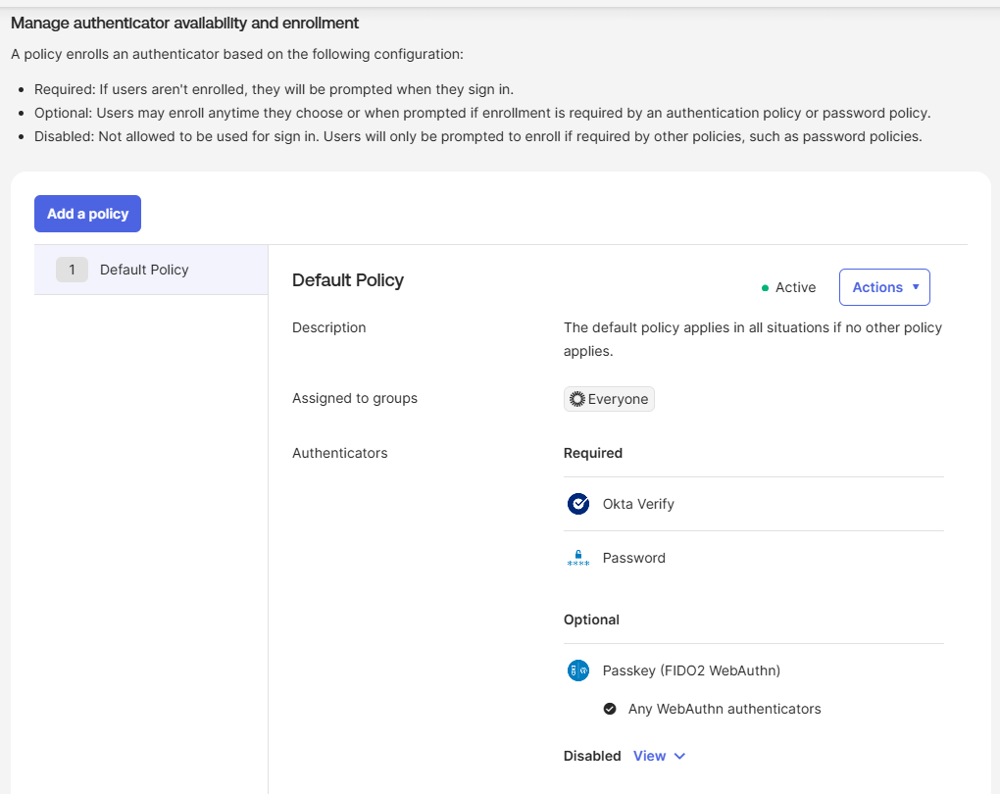

**App sign-in policy (`Edao - MFA Required`):** I built a custom authentication policy (Okta's equivalent of Entra Conditional Access) with the rule *All staff – require MFA*:

- **Any 2 factor types** are required
- **Possession factor constraints:** phishing-resistant, user interaction required
- **Re-authentication:** every 1 hour

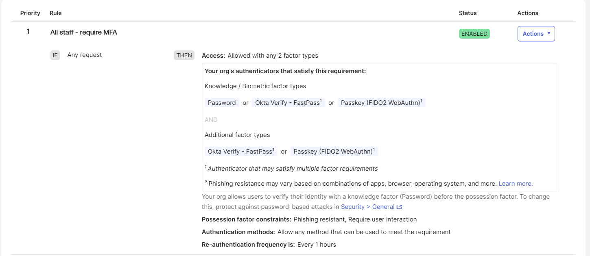

## 4. SSO: proving who gets in

**The app.** Registered *Edao Finance Portal* as an OIDC web app with an Okta-generated client ID. I enabled only the grants the test needed. Under implicit, I allowed the **ID token** and **turned off the access token**, since nothing in this test consumes one (least privilege). [OIDC Debugger](https://oidcdebugger.com) acted as the app, so I could inspect exactly what Okta returned.

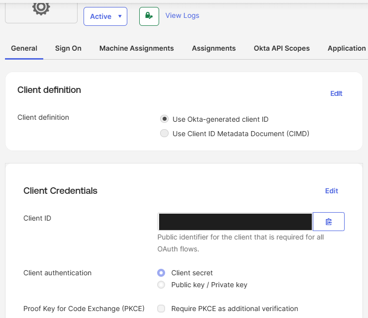

**Who can use it.** The app is assigned to **GRP-Finance only**, never to individuals:

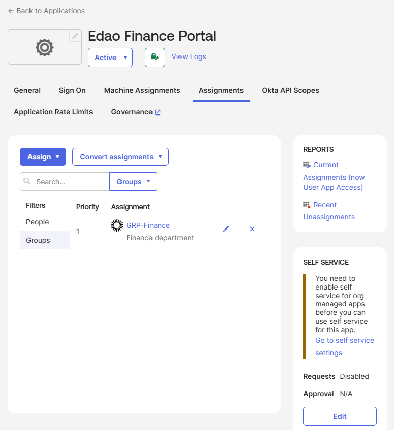

**Which policy protects it.** The *Edao - MFA Required* policy is attached to the app:

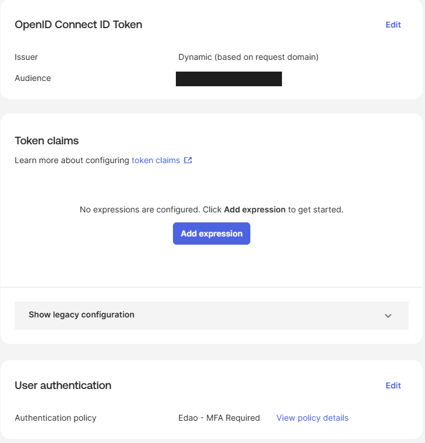

### ✅ Maya Chen (Finance): allowed

Maya signed in, enrolled Okta Verify, and Okta returned a signed ID token. The returned `state` matched the one sent, which protects against forged responses.

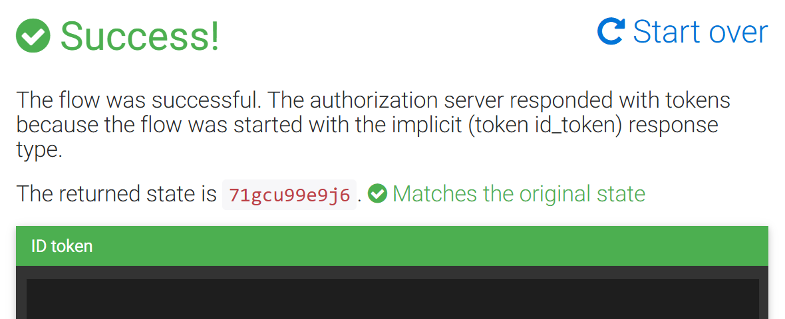

**Reading the token.** I decoded the ID token to verify *how* she authenticated, not just *that* she did:

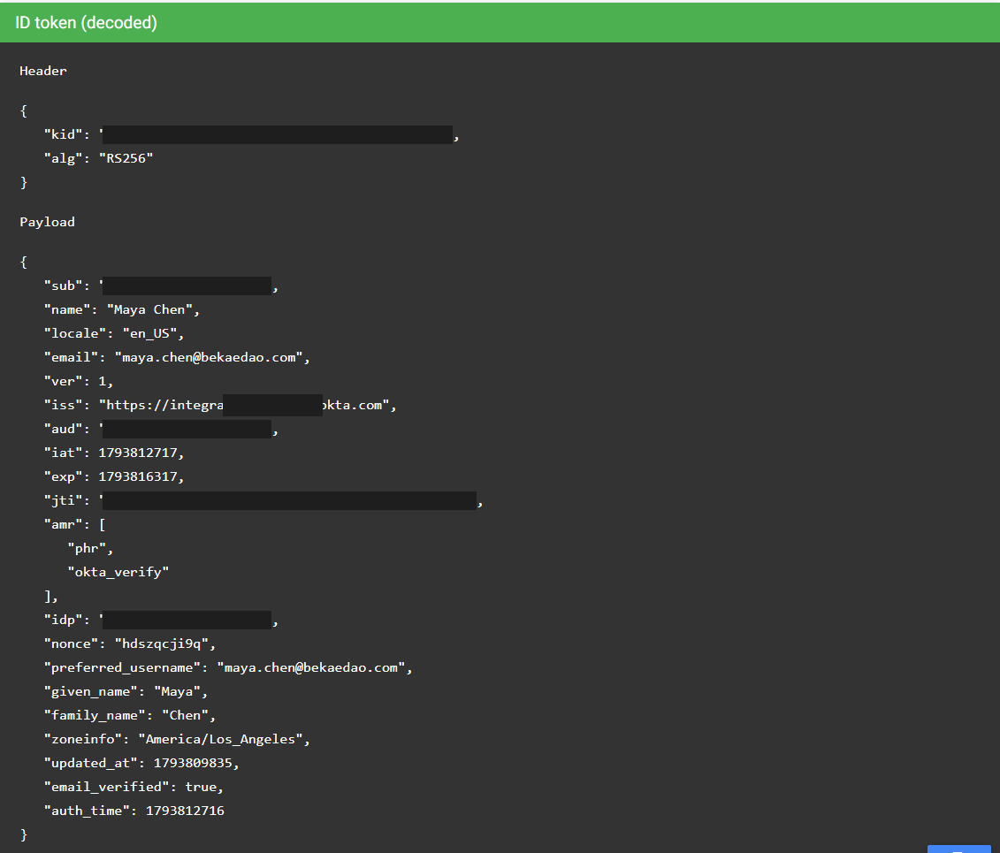

| Claim | Value | What it proves |
| --- | --- | --- |
| `alg` | RS256 | Token is signed with Okta's private key, so the app can verify it wasn't tampered with |
| `iss` / `aud` | my Okta org / my client ID | Issued by the right identity provider, for this specific app |
| `amr` | `phr`, `okta_verify` | She authenticated with **Okta Verify FastPass**, a **phishing-resistant** method |
| `nonce` | matches request | Token can't be replayed from an earlier sign-in |
| `exp` – `iat` | 1 hour | Short-lived token |

> **Note:** `amr` doesn't include `pwd`. On this sign-in, Okta Verify FastPass (desktop) satisfied the policy without a password, since a single authenticator can satisfy multiple factor requirements. That's stronger than password + one-time code, because FastPass is bound to the real Okta domain and the user's device, so a phishing page can't capture anything reusable.

### ❌ Carlos Rivera (Sales): denied

Same app, same sign-in page. Okta refused because Carlos isn't in GRP-Finance:

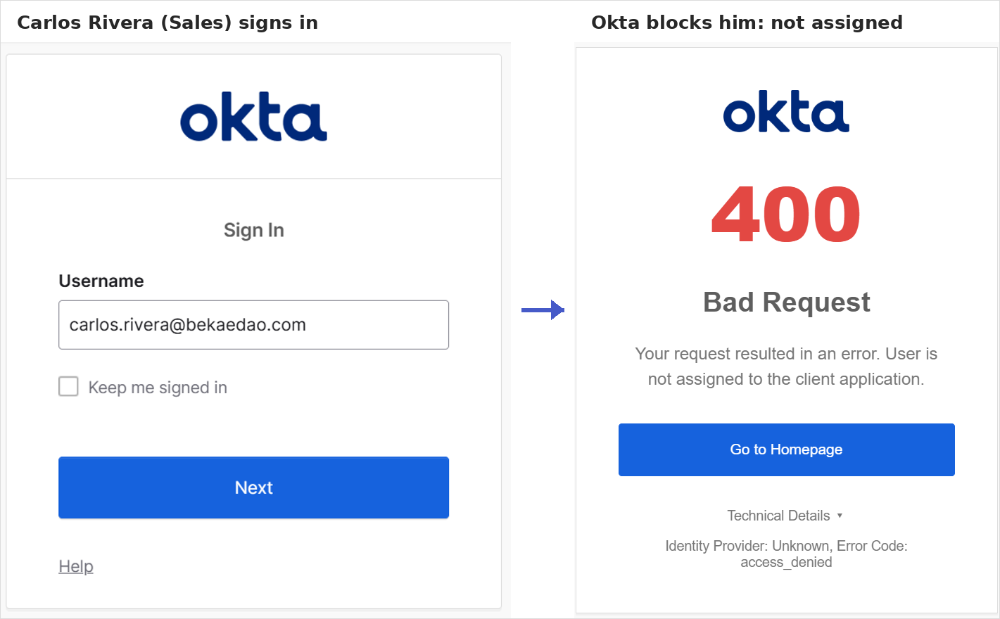

---

## 5. Lifecycle: joiner, mover, leaver

### Joiner – Nina Park, new Finance hire

I created Nina and set `department = Finance`. With **no manual assignment**, Okta added her to GRP-Finance and to Edao Finance Portal within seconds. The System Log shows the actor as **Okta System**, meaning the automation did it, not an admin.

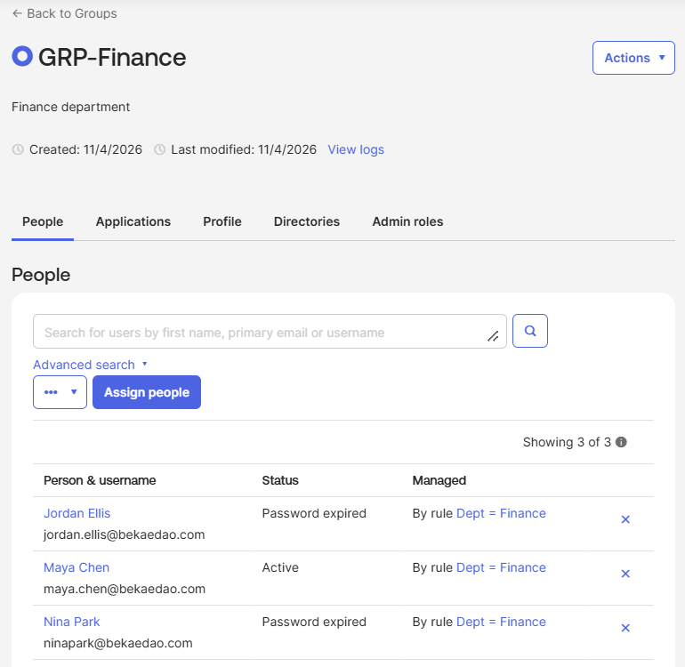

### Mover – Jordan Ellis, Finance → Sales

I changed one field: Jordan's department from Finance to Sales. Okta removed him from GRP-Finance **and** revoked his Finance app access automatically. Removing old access is the half of the mover process that's most often missed in real organizations.

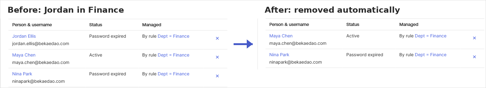
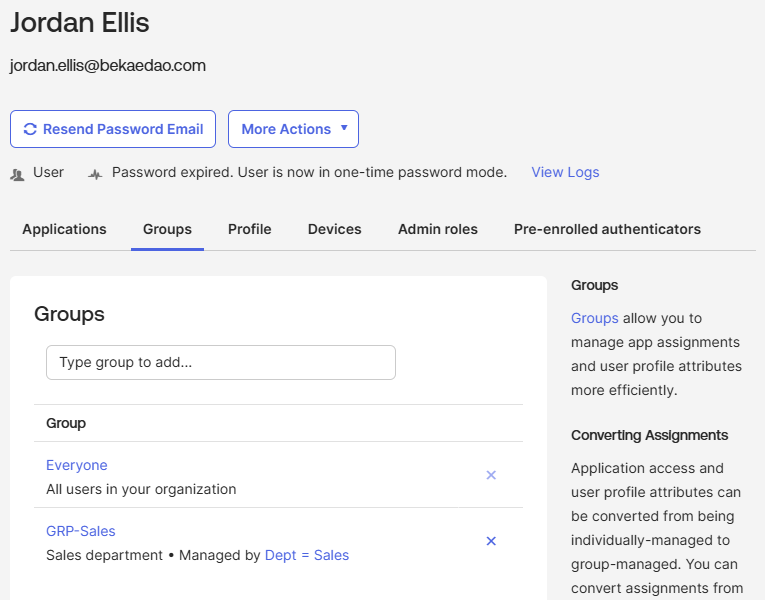

When he tried the Finance app again, he was denied:

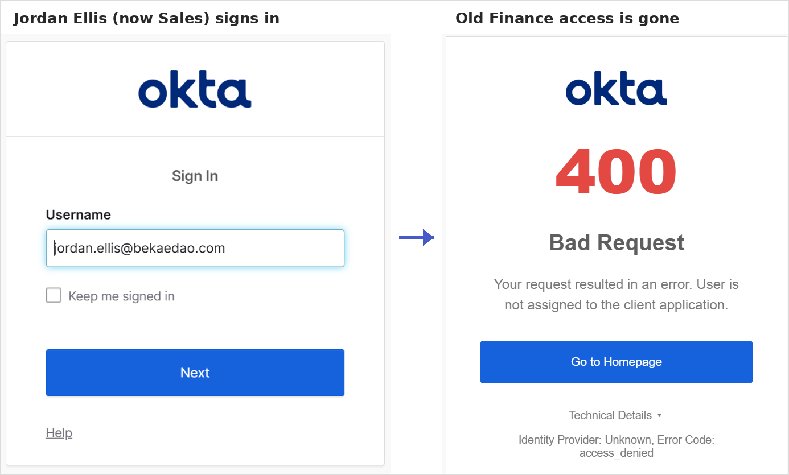

### Leaver – Maya Chen leaves the company

I **deactivated** Maya rather than suspending her. Suspend blocks sign-in but keeps everything (for leave or an investigation). Deactivate is the offboarding action: it ends sessions and removes app access.

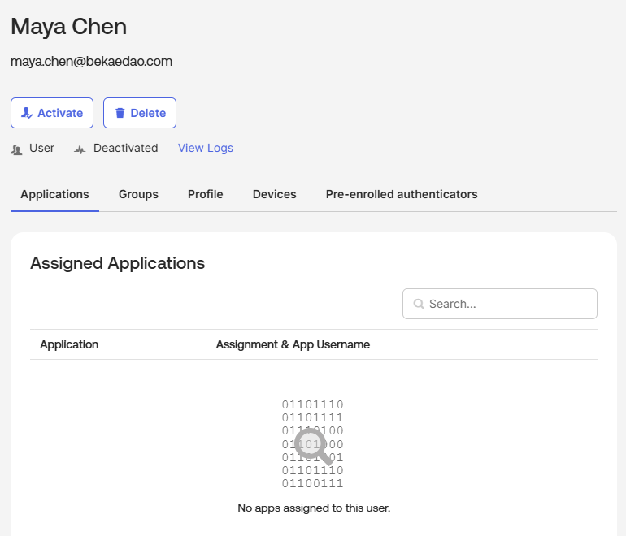

Her next sign-in attempt failed:

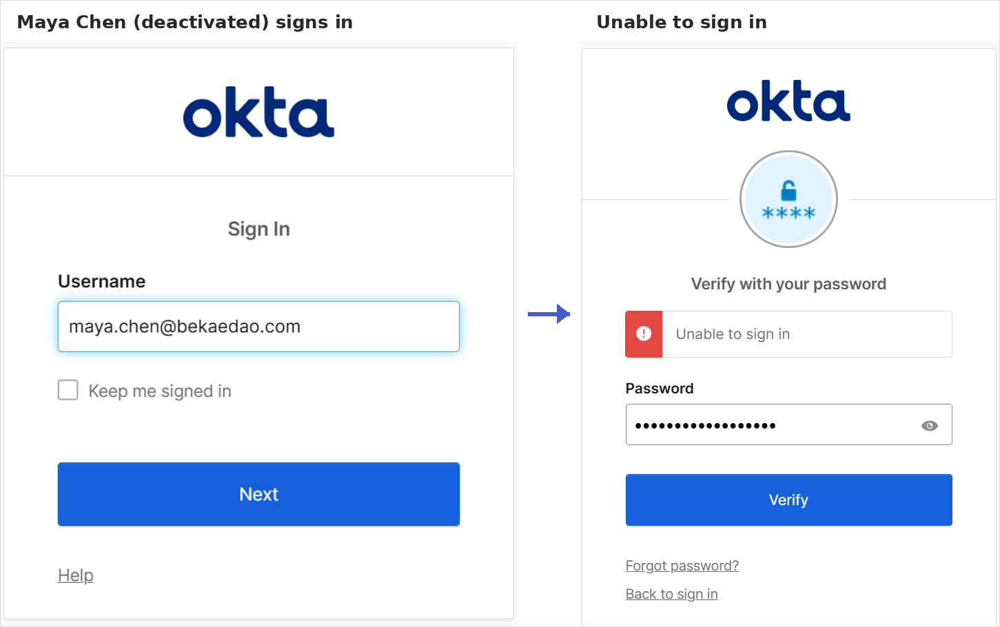

---

## 6. Audit evidence (System Log)

Every claim above is backed by Okta's System Log. Key events (Nov 4, 2026):

| Time | Actor | Event | Meaning |
| --- | --- | --- | --- |
| 12:18:37 | Maya Chen | User single sign on to app – SUCCESS | SSO worked for an assigned user |
| 12:23:02 | Carlos Rivera | User attempted unauthorized access to app – FAILURE | Not-assigned user blocked |
| 12:27:24 | **Okta System** | Add user to group membership / application membership (Nina) | Joiner automated |
| 12:28:41 | **Okta System** | Remove user from group / application membership (Jordan) | Mover removed old access automatically |
| 12:34:03 | Admin | Add user to group membership (Jordan → GRP-Sales) | New access after the rule fix (see below) |
| 12:37:49 | Jordan Ellis | OIDC authorization request – FAILURE `user_not_assigned` | Old access really gone |
| 12:40:32 | Admin | Remove app membership → Deactivate → Logout → Clear session (Maya) | Leaver: all four in the same second |
| 12:41:56 | Maya Chen | User login to Okta – FAILURE | Deactivated user can't sign in |

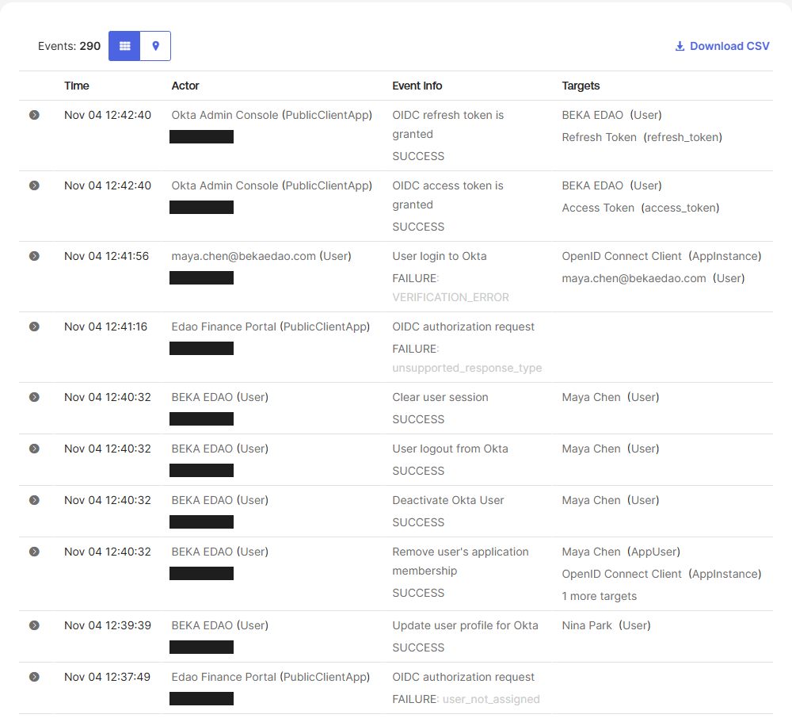
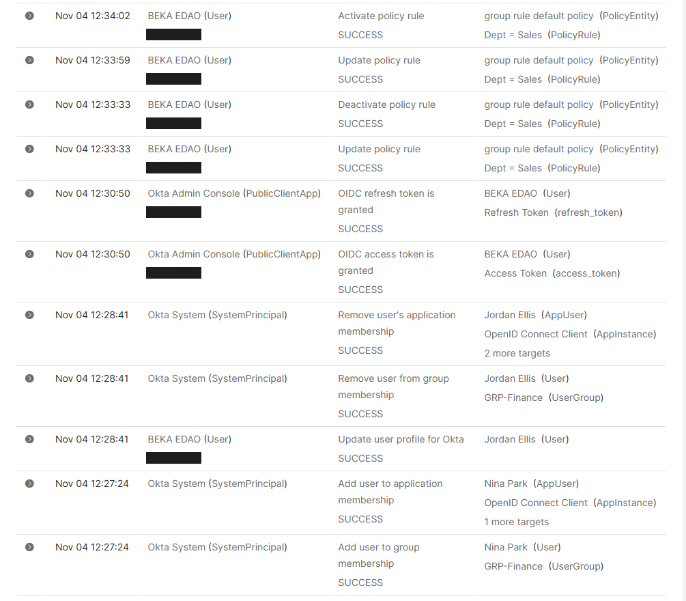

Filtered per person, each user's full story is in one view:

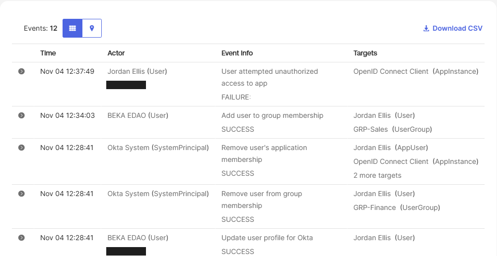
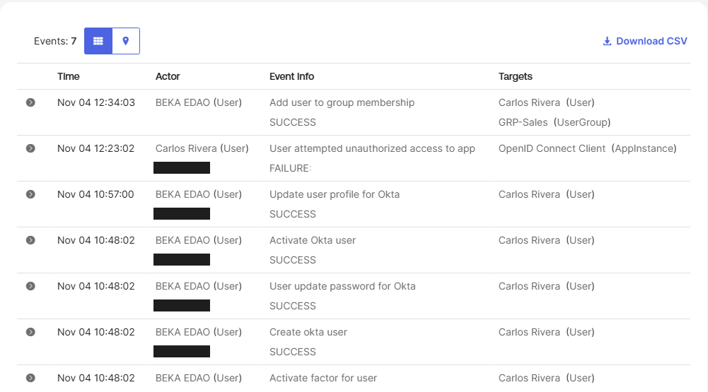
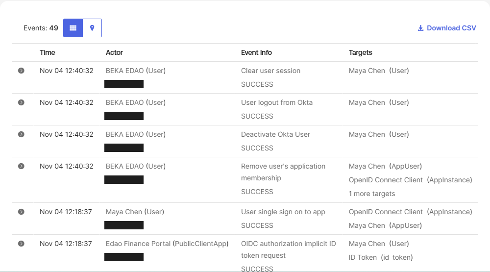

*Source IP addresses are redacted.*

---

## What went wrong and how I fixed it

**1. A misconfigured group rule, caught by the mover test.**
After Jordan's transfer, he left GRP-Finance but never arrived in GRP-Sales, and Carlos and Aisha weren't in it either. Opening the rule showed it was matching on **`login`** instead of **`department`**:

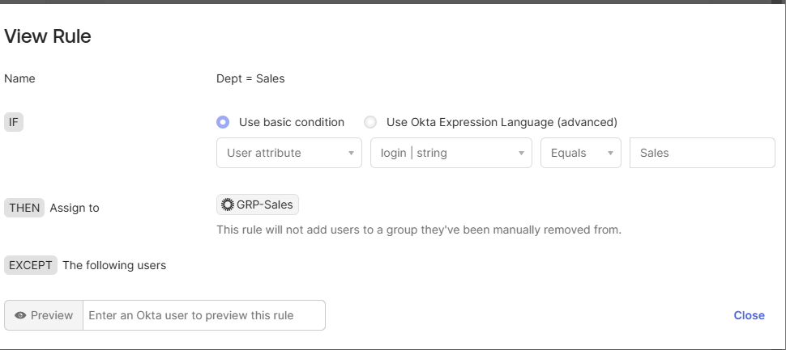

The HR, IT and Sales rules all had this mistake. Only Finance was built correctly, and because the first SSO test used Finance, everything *looked* fine. I deactivated each rule, corrected the attribute, reactivated it, and confirmed all users populated. The System Log shows the fix at 12:33–12:34.
*Lesson:* test every rule, not just the first one, and treat a mover as a test of both halves of the change.

**2. Okta rejected Gmail at sign-up.** The free developer plan requires a business email. I registered a domain and set up Cloudflare Email Routing (one address for me, plus a catch-all for test users) instead of using a throwaway address.

**3. `404 Not Found` on the authorization request.** I'd used the admin console hostname (`…-admin.okta.com`). The OIDC endpoint lives on the org's sign-in domain, without `-admin`.

**4. `400 unsupported_response_type`.** Both `code` and `id_token` were selected, so the request asked for a combination the app wasn't configured for. Okta only allows the response types the app is registered for, so I requested `id_token` alone.

**5. Okta Verify desktop enrollment stalled.** Okta offered desktop Okta Verify (FastPass) on Windows, and the enrollment page didn't advance inside a private browser window, because the browser-to-app handoff was blocked. Restarting the sign-in let FastPass verify the user, which is also why the token shows a phishing-resistant method.

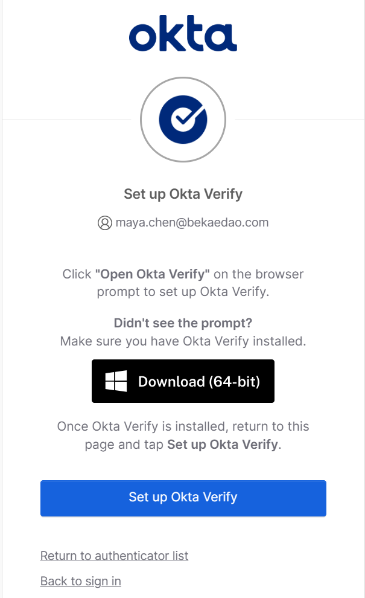

**6. The admin console UI differed from older documentation.** New options like *Client ID Metadata Document (CIMD)* appeared, and the implicit-grant sub-options only showed after the app was saved. I picked the standard Okta-generated client ID and verified the settings after saving.

---

## Security decisions

- **Group-based access only.** No user is assigned to the app directly, so access is always explainable by group membership, which is easy to review and audit.
- **Attribute-driven automation.** Department is the single source of truth, which removes human error from joiner/mover access changes.
- **Phishing-resistant MFA** required by policy, with hourly re-authentication.
- **Minimal grants.** Implicit access tokens are off; only what the test needed is enabled.
- **Deactivate vs. suspend** chosen intentionally for offboarding.
- **No secrets exposed.** The client secret was never displayed, and tokens, IDs and IP addresses are redacted from all screenshots.

## What I'd do in production

- **Use Authorization Code + PKCE** instead of the implicit flow. Implicit was used here only because the test tool displays the ID token directly; current OAuth security guidance discourages implicit for real apps.
- **Add a second super admin** (and a break-glass account), resolving Okta's to-do warning.
- **Drive lifecycle from an HR system** (e.g. Workday) as the profile source, instead of editing attributes by hand.
- **SCIM provisioning** so app accounts are created and deactivated in the app itself, not just in Okta.
- **Monitoring:** alert on repeated `user_not_assigned` or failed-MFA events, and stream the System Log to a SIEM.
- **Quarterly access certification** of group membership.

## Okta vs. Entra ID (from Labs 2 and 3)

| Concept | Microsoft Entra ID (Lab 2) | Okta (Lab 3) |
| --- | --- | --- |
| Attribute-based groups | Dynamic groups | Group rules |
| Sign-in conditions | Conditional Access | Authentication policies |
| MFA app | Microsoft Authenticator | Okta Verify / FastPass |
| Audit trail | Sign-in and audit logs | System Log |
| Privileged access | PIM (just-in-time roles) | Admin roles (no JIT used here) |

## Skills demonstrated

Okta Workforce Identity · OpenID Connect (OIDC) · JWT / ID token analysis · Authentication policies · Phishing-resistant MFA (Okta Verify FastPass) · Group rules / attribute-based access · Joiner–Mover–Leaver lifecycle · Least privilege · System Log audit evidence · Troubleshooting OAuth errors
