# Lab 4: AWS IAM Identity Center Federated to Microsoft Entra ID

> **Goal:** Give Edao Logistics employees access to AWS with their existing Entra ID accounts, with no separate AWS passwords. Users and groups flow from Entra to AWS automatically, each department gets only the AWS permissions its job needs, and disabling someone in Entra cuts off their AWS access too. Every claim is backed by Entra provisioning logs and AWS CloudTrail.

**Platforms:** AWS IAM Identity Center (organization instance) · Microsoft Entra ID (from [Lab 2](../02-entra-id/README.md)) · **Company:** Edao Logistics (fictional) · **Protocols:** SAML 2.0 (sign-in) + SCIM 2.0 (provisioning)

---

## Results at a glance

| Test | Expected | Result | Evidence |
| --- | --- | --- | --- |
| IT user (Lena) signs in to AWS from Entra | Allowed, as `IT-PowerUser` | ✅ Federated into the AWS console with a temporary role | [Step 7](#7-validation-who-gets-in-and-what-they-can-do) |
| IT user opens IAM | Denied (PowerUser can't manage identities) | ✅ `iam:GetAccountSummary` access denied | [Step 7](#7-validation-who-gets-in-and-what-they-can-do) |
| Finance user (Maya) creates an S3 bucket | Denied (view only) | ✅ `s3:CreateBucket permission is required` | [Step 7](#7-validation-who-gets-in-and-what-they-can-do) |
| HR user (Priya) signs in to AWS | Denied (not assigned) | ✅ Entra blocks her with `AADSTS50105` | [Step 7](#7-validation-who-gets-in-and-what-they-can-do) |
| Denied in the Lab 2 access review (Jordan) | Never reaches AWS | ✅ Not provisioned: only 3 users exist in AWS | [Step 5](#5-scim-automatic-provisioning) |
| **Leaver:** Maya disabled in Entra | Disabled in AWS too | ✅ SCIM sets `active = false`, AWS shows *Disabled*, CloudTrail logs `DisableUser` | [Step 8](#8-leaver-disable-once-locked-out-everywhere) |

---

## Architecture

**How sign-in works (SAML 2.0)**

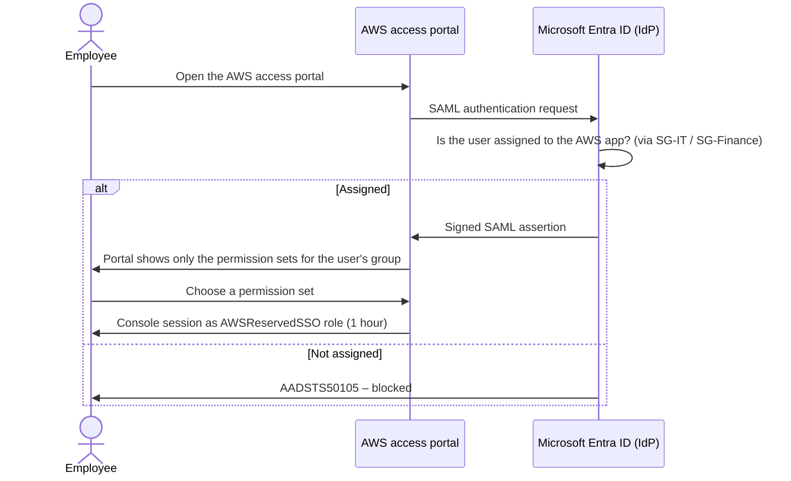

**How identities and access flow (SCIM 2.0 + permission sets)**

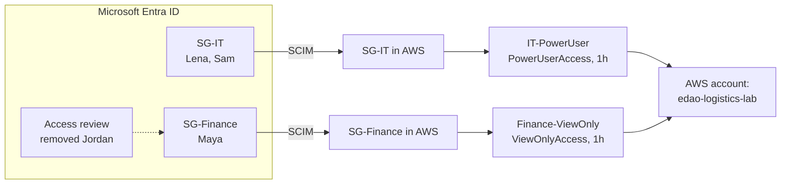

Entra is the **single source of truth**. AWS never stores a password, and nobody is added to AWS by hand. Access always flows **Entra group → AWS group → permission set → AWS account**.

---

## 1. Secure the AWS account first

Before building anything, I locked down the root user (the all-powerful account owner):

- Turned on **MFA for the root user**
- Created a **zero-spend budget** that emails me if anything costs even $0.01

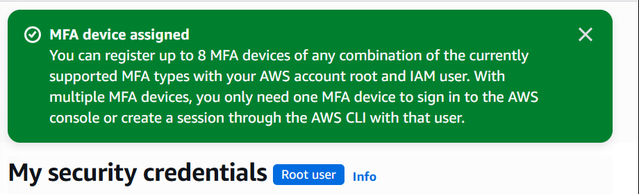
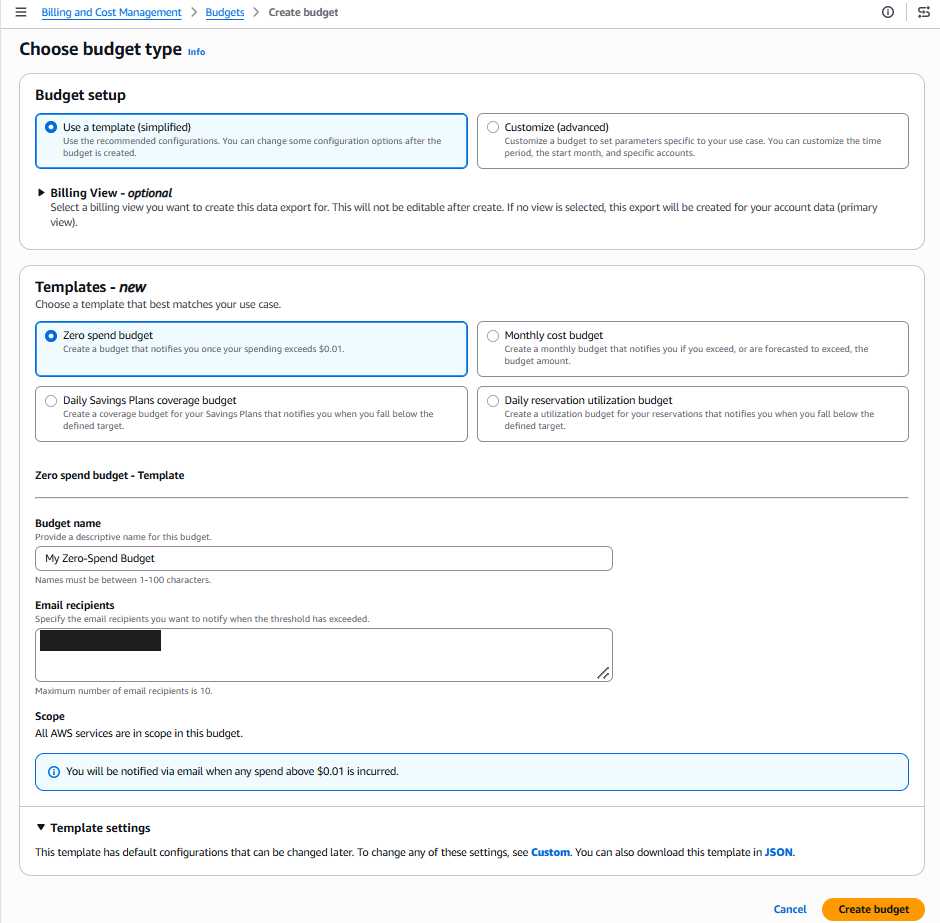

## 2. Enable IAM Identity Center (organization instance)

IAM Identity Center is AWS's workforce sign-in service. I enabled the **organization instance**, which can manage access to every account in an AWS Organization, not just one.

AWS proposed a **multi-Region** instance by default. That option encrypts with a customer-managed **KMS key**, which has a monthly cost (see the warning at the bottom). For a single-account lab I chose **Single-Region (US East, N. Virginia)** instead, so there is nothing to bill.

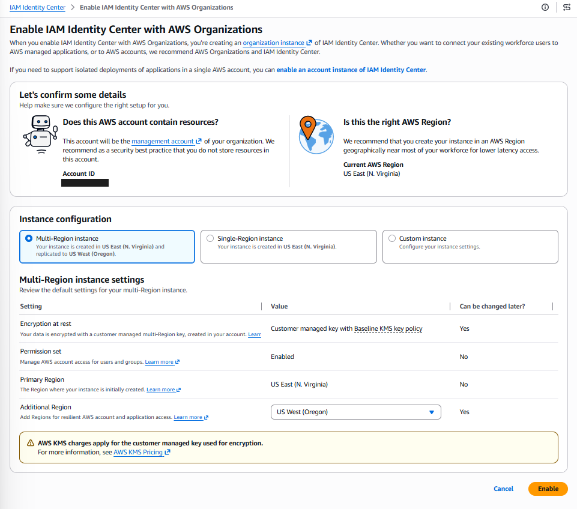
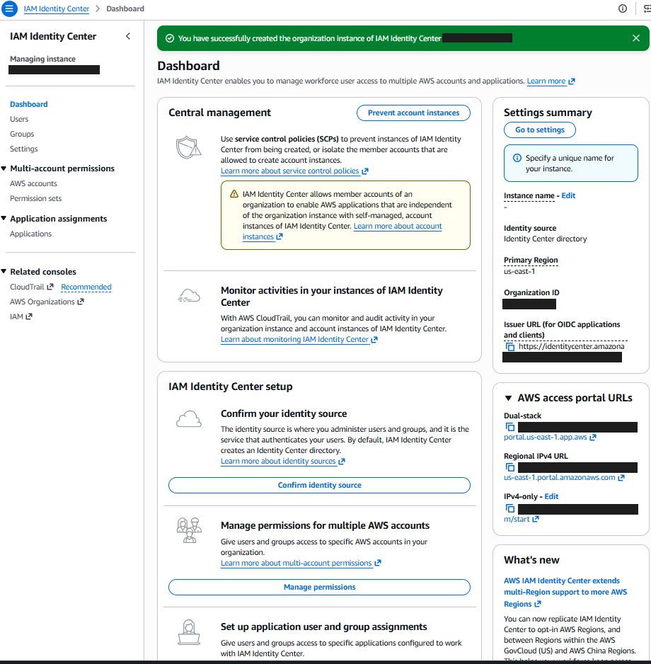

## 3. SAML federation: Entra as the identity provider

In Entra, I added the gallery app **AWS IAM Identity Center** and set up SAML single sign-on by exchanging metadata:

1. Downloaded AWS's service provider metadata and uploaded it to Entra (fills in the Identifier and Reply URL)
2. Set the **Sign on URL** to the AWS access portal URL
3. Downloaded Entra's **Federation Metadata XML** and uploaded it to AWS

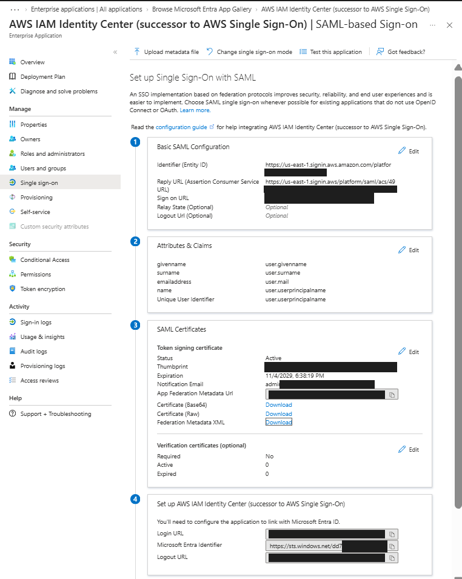

In AWS, I changed the identity source from the built-in directory to **External identity provider**. AWS confirmed the change and now trusts Entra's signing certificate.

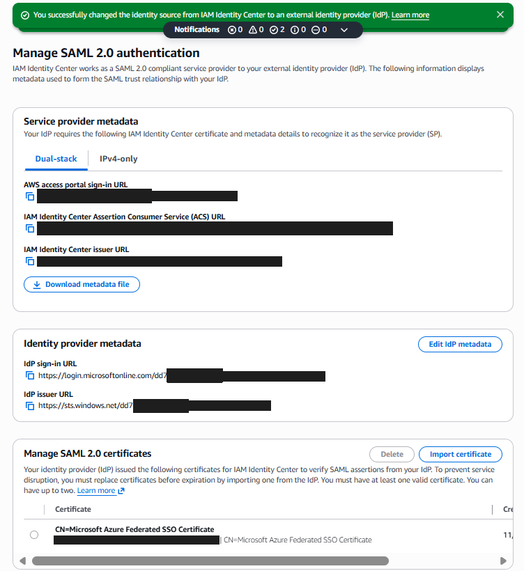

## 4. Only assigned groups can use the app

In the Entra app, **Assignment required** is set to **Yes**, and I assigned exactly two groups: `SG-IT` and `SG-Finance`. Anyone outside those groups is blocked at Entra before AWS is ever involved.

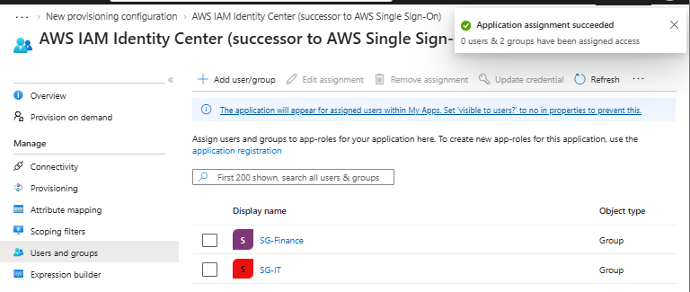

## 5. SCIM: automatic provisioning

SAML only handles *sign-in*. AWS also needs the users and groups to exist on its side. Instead of creating them by hand, I turned on **automatic provisioning** in AWS, which gave me a SCIM endpoint and an access token. I pasted both into Entra's provisioning settings (the token was never screenshotted or saved anywhere else) and set the scope to **assigned users and groups only**.

I tested with **Provision on demand** before starting the full sync. The `SG-IT` group was created in AWS right away:

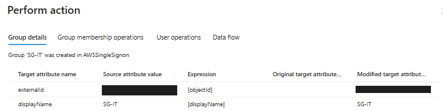

But both IT users **failed**. See [What went wrong](#what-went-wrong-and-how-i-fixed-it) for how I fixed it. After the fix, Lena and Sam were added to the group, followed by Maya in `SG-Finance`:

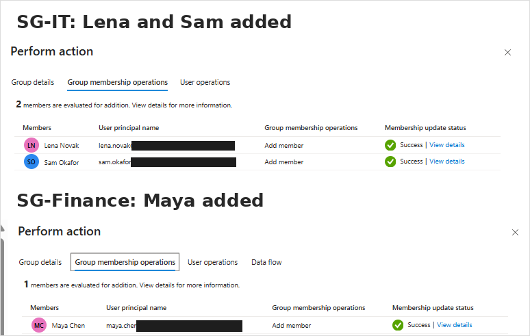

Then I started provisioning. The initial sync completed with **3 users and 2 groups**, and Entra now re-syncs every 40 minutes.

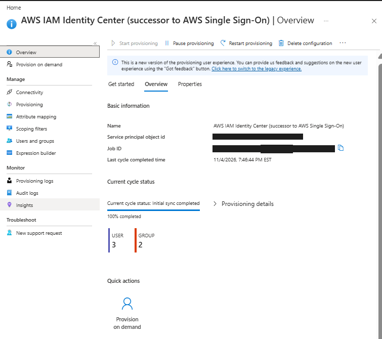

AWS now shows the same users and groups, all marked **Created by: SCIM**. Notice who is *not* there: **Jordan Ellis**. My [Lab 2 access review](../02-entra-id/README.md#7-access-review-catching-access-that-nobody-cleaned-up) had already removed him from `SG-Finance`, so he was never provisioned into AWS. Cleaning up access at the source stopped it from spreading.

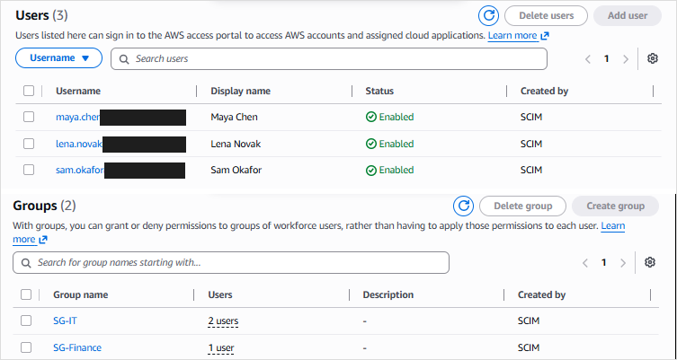

## 6. Least-privilege permission sets

A **permission set** is a template of AWS permissions. When it's assigned, AWS turns it into a role inside the account. I created one per job function, each with a **1-hour session**:

| Permission set | AWS managed policy | Assigned to | What it allows |
| --- | --- | --- | --- |
| `IT-PowerUser` | PowerUserAccess | `SG-IT` | Build and run AWS services, but **no** IAM or Organizations management |
| `Finance-ViewOnly` | ViewOnlyAccess | `SG-Finance` | See resources and settings, change nothing |

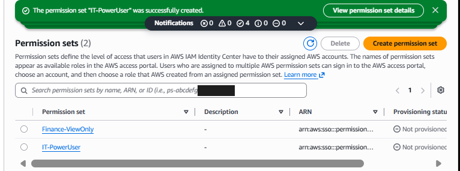
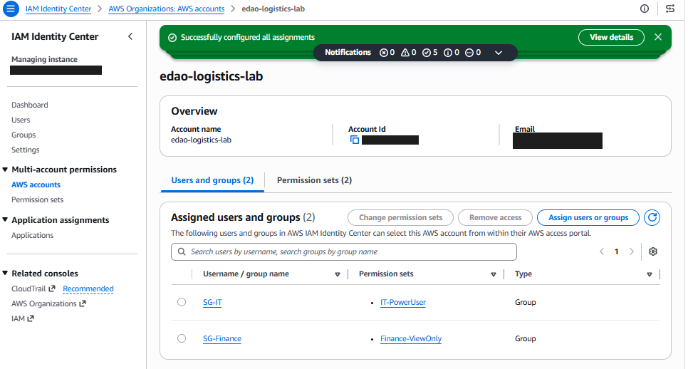

AWS created the matching roles automatically. Their names start with `AWSReservedSSO_`, and they trust only the Identity Center SAML provider, so no one can assume them any other way.

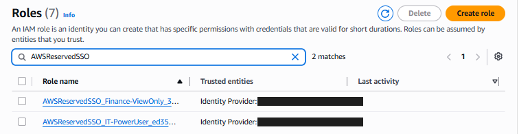

## 7. Validation: who gets in, and what they can do

**Lena Novak (IT): allowed, as `IT-PowerUser`.** She signed in with her Entra account. The portal showed only her one permission set, and the console identifies her as a federated user in the `AWSReservedSSO_IT-PowerUser` role.

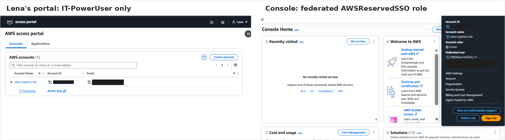

**Lena opens IAM: denied.** PowerUser can run services but can't manage identities. That keeps an IT engineer from granting themselves more access.

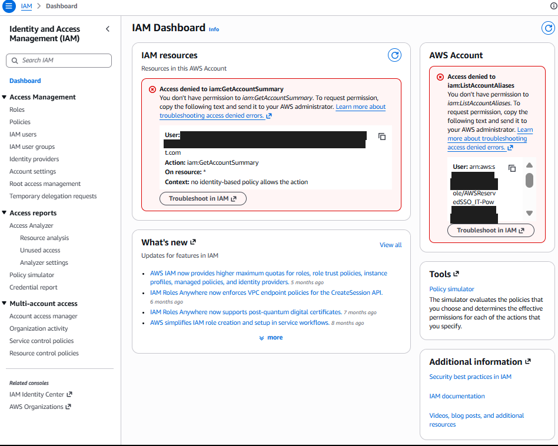

**Maya Chen (Finance): view only.** Her portal shows only `Finance-ViewOnly`. When she tried to create an S3 bucket, AWS refused.

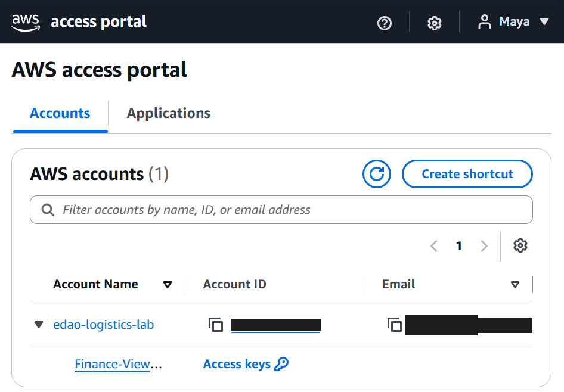
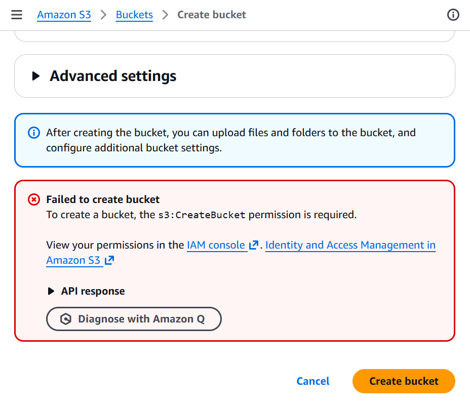

**Priya Patel (HR): not assigned.** HR has no AWS access. Entra blocked her before she ever reached AWS (`AADSTS50105`: not a member of an assigned group).

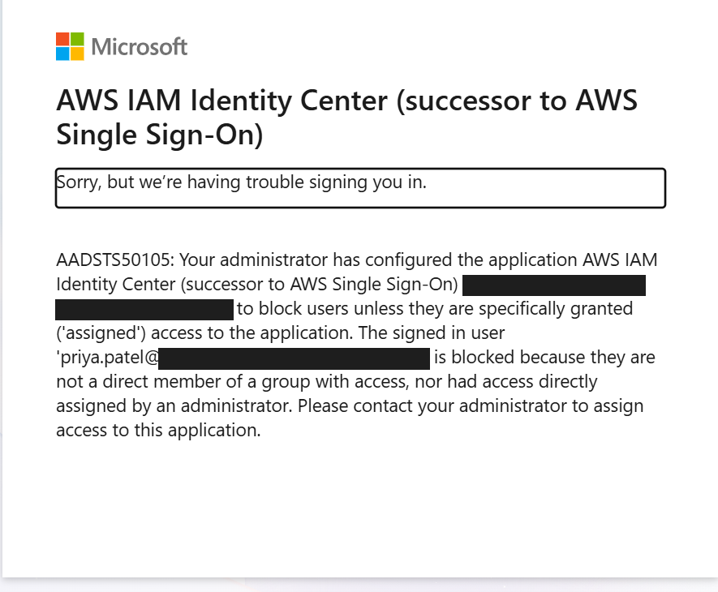

## 8. Leaver: disable once, locked out everywhere

Scenario: Maya leaves the company. I disabled her account **in Entra only**, then used **Provision on demand** to push the change immediately instead of waiting for the 40-minute cycle. SCIM sent `active = false` to AWS:

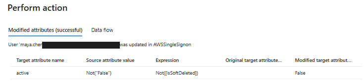

AWS now shows Maya as **Disabled**, and Entra refuses her sign-in, so there is no path to the AWS portal.

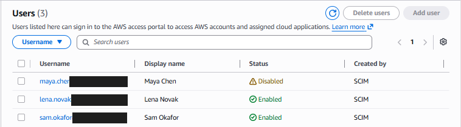
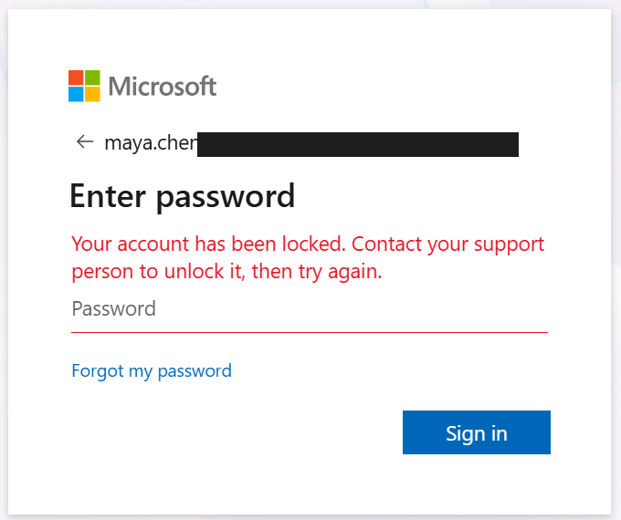

---

## Audit evidence

**Entra provisioning logs** record every create, update, skip and disable, with the source (Entra ID) and target (AWS).

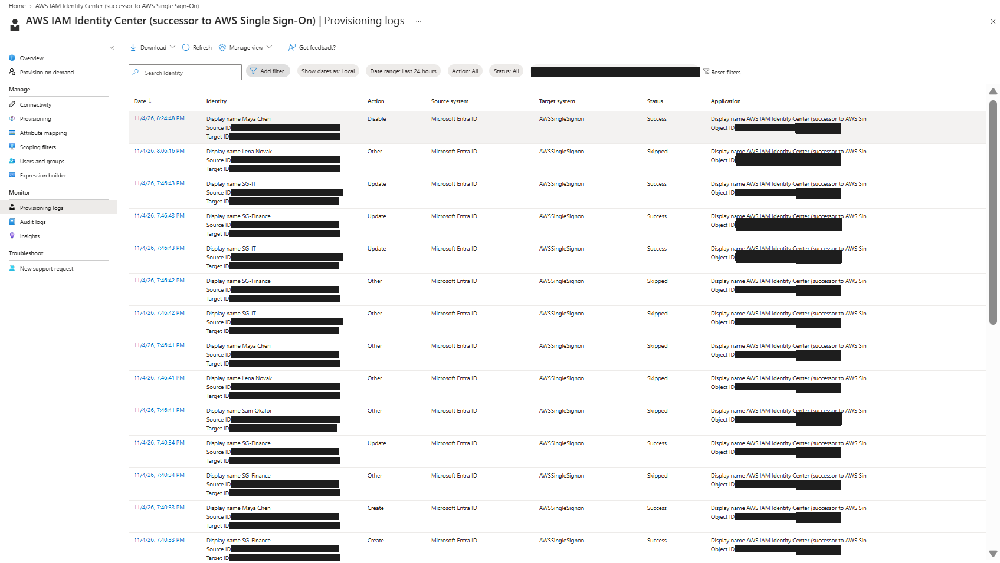

**AWS CloudTrail** records the same story from the AWS side. Filtering Event history to write events (*Read-only = false*) shows:

| Time (Nov 4, 2026) | Event | Who | Meaning |
| --- | --- | --- | --- |
| 20:03:44 | `Federate`, `ConsoleLogin` | lena.novak | Lena signs in through Entra → AWS |
| 20:10:26 – 20:10:27 | `Federate`, `ConsoleLogin` | maya.chen | Maya signs in through Entra → AWS |
| 20:24:48 | `PatchUser` (identitystore-scim) | SCIM (Entra) | Entra's SCIM request sets Maya to inactive |
| 20:24:48 | `DisableUser` (sso-directory) | SCIM (Entra) | Identity Center disables Maya |

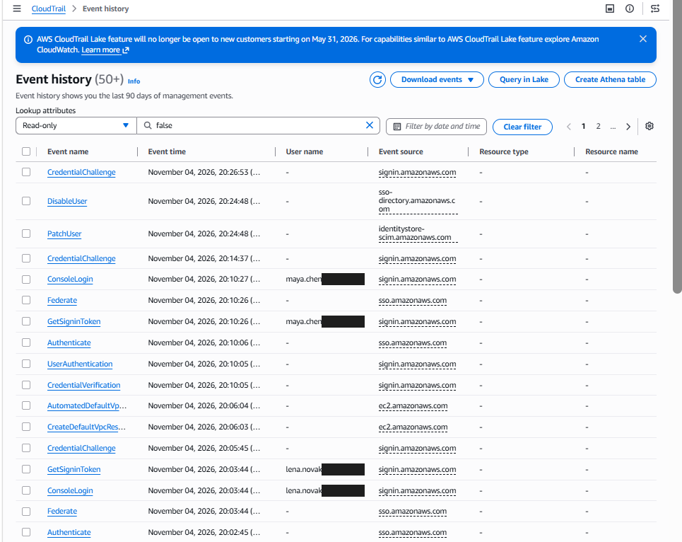
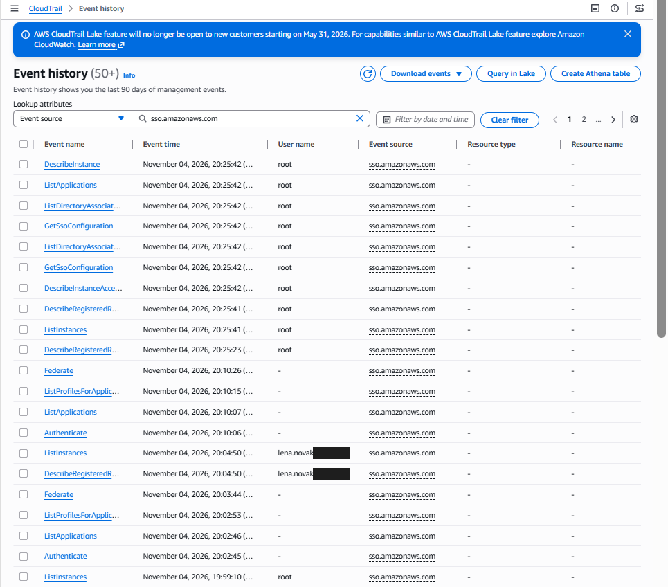

> `CreateDefaultVpcResources` and `AutomatedDefaultVpc` also appear in the log. AWS creates a default network when a new Region is first opened in the console. They are free and expected.

---

## Security decisions

- **Federation instead of IAM users.** No long-lived AWS passwords or access keys exist for employees. Every session is a temporary role.
- **Assignment required = Yes**, and only two groups are assigned. Unassigned users are stopped at Entra (proven with Priya).
- **Provisioning scope: assigned users and groups only**, so the rest of the tenant never syncs to AWS.
- **Least privilege by job function.** IT gets PowerUser (no IAM), Finance gets ViewOnly.
- **1-hour sessions.** Disabling a user blocks new sign-ins right away, but an already-open console session lasts until it expires. A short session limits that window.
- **Root user locked down:** MFA, plus a zero-spend budget alert.
- **Single-Region instance** to avoid KMS key charges in a lab with no multi-Region need.
- **Root email is my long-term personal address**, not the lab domain. If a custom domain ever lapses, whoever registers it could reset the root password.
- **Secrets stay secret.** The SCIM token and SAML certificate details never appear in screenshots; account, tenant, object and instance IDs are redacted.

## What went wrong and how I fixed it

- **SCIM `400: The attribute name is required`.** Lena and Sam failed to provision with `SystemForCrossDomainIdentityManagementServiceIncompatible`. AWS requires `name.givenName` and `name.familyName`, and my Lab 2 users only had display names. I filled in **First name** and **Last name** in Entra and re-ran Provision on demand.

  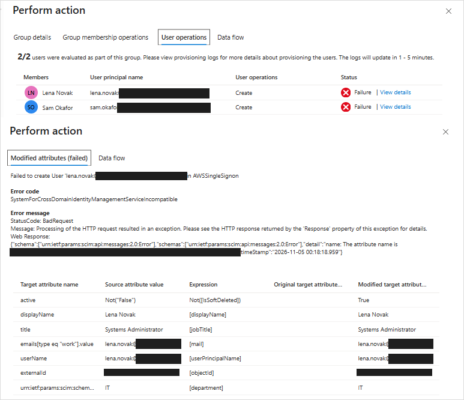

- **Sam was skipped (`RedundantExport`).** After the fix, Lena went through but Sam's group membership was skipped because his earlier user create had failed. Re-provisioning Sam on his own created him, and then his membership succeeded.

  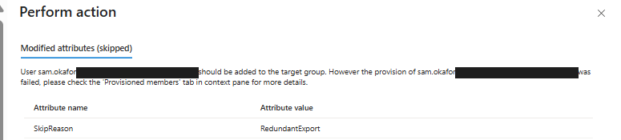

- **"Please enter a valid URL" on the Sign on URL.** The URL looked right, but I had pasted it with a **trailing space**. Deleting the space fixed it.

  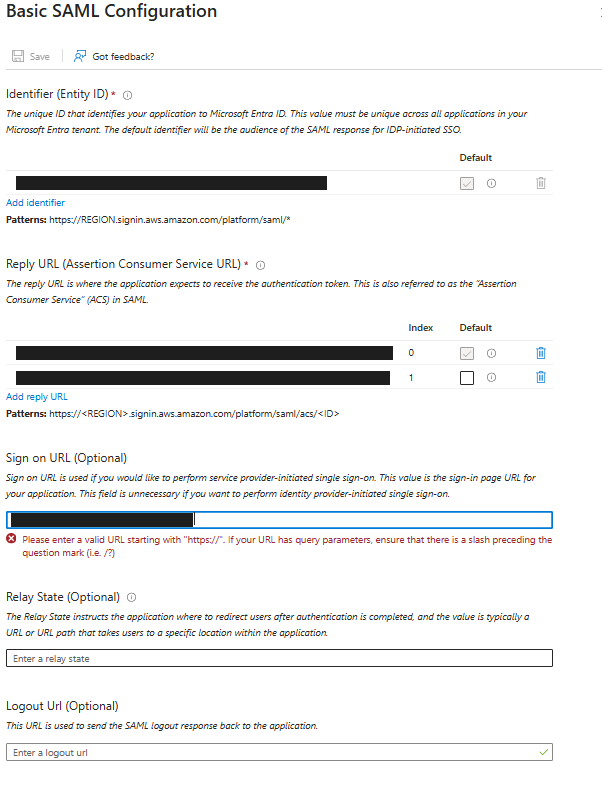

- **"Bad request" when signing in as root.** Old cookies from an earlier AWS sign-in were getting in the way. A clean browser session (Microsoft Edge) worked. I also learned that an **AWS Builder ID** is a separate developer profile, not an AWS account login.
- **Free plan vs. paid plan.** AWS's newer Free plan doesn't support AWS Organizations, which the organization instance of Identity Center needs. I chose the paid plan with Basic (free) support and protected it with the zero-spend budget.
- **A misleading S3 error.** My first bucket-name attempt as Maya returned *"bucket with the same name already exists,"* which hid the real cause. With a different name, AWS returned the honest answer: `s3:CreateBucket permission is required`. Lesson: when testing a denial, make sure the request is valid so the permission check is the thing being tested.

## What I'd do in production

- **Stop using root.** I used the root user to set up this lab. In production I'd create a dedicated Identity Center admin permission set for named admins and keep root for break-glass only, with its MFA device stored securely.
- **Multi-account structure.** Use separate accounts (production, development, security/log archive) under AWS Organizations, with service control policies as guardrails.
- **Multi-Region instance** for resilience if the business needed it, accepting the KMS cost.
- **Group-based app assignment requires Entra ID P1 or higher** for every user. Budget for it rather than assigning users one by one.
- **Monitor provisioning.** Set up email alerts for provisioning failures and quarantine, and review the logs during each access review.
- **Rotate the SCIM token** before it expires (AWS tokens last one year), and track the date.
- **Send CloudTrail to a central log archive** with a longer retention period than the 90-day Event history.
- **Pair disable with session revocation** for high-risk leavers, so an already-open session ends immediately.

## Skills demonstrated

AWS IAM Identity Center · SAML 2.0 federation · SCIM 2.0 provisioning · Microsoft Entra ID enterprise apps · Permission sets and least privilege · AWS Organizations · IAM roles (AWSReservedSSO) · Joiner/leaver automation · AWS CloudTrail · Entra provisioning logs · Troubleshooting API errors · Cost controls (budgets, KMS awareness)
