# Lab 5: Identity Automation with Python and Microsoft Graph

> **Goal:** Replace portal clicking with code. Five Python scripts call the Microsoft Graph API to audit Edao Logistics' identities (inventory, stale accounts and MFA coverage) and to run the joiner and leaver processes end to end. A new hire created by one script reached **AWS** through the SCIM pipeline from [Lab 4](../04-aws/README.md), and the leaver script cut that access off again, without anyone opening the AWS console to make the change.

**Platforms:** Microsoft Entra ID · Microsoft Graph API (v1.0) · AWS IAM Identity Center (from Lab 4) · **Language:** Python 3.14 (`requests`, `msal`, `python-dotenv`) · **Auth:** OAuth 2.0 client credentials flow

---

## Results at a glance

| Script | What it does | Result |
| --- | --- | --- |
| [`01_user_inventory.py`](01_user_inventory.py) | Exports every user with department, title and account status | ✅ 11 users, 1 disabled (Maya Chen, the Lab 4 leaver) |
| [`02_stale_accounts.py`](02_stale_accounts.py) | Flags accounts with no sign-in for 30+ days, or none ever | ⚠️ **5 enabled accounts have never signed in**, including an IT user with AWS PowerUser access |
| [`03_mfa_report.py`](03_mfa_report.py) | Rates every user's MFA registration by risk | ⚠️ **20% MFA coverage**, and 2 admin accounts with no MFA visible to Entra |
| [`04_joiner.py`](04_joiner.py) | Creates new hires from an HR CSV and adds them to their department group | ✅ Daniel Kim created → `SG-IT` → provisioned to AWS |
| [`05_leaver.py`](05_leaver.py) | Disables the account, revokes sessions, removes groups, logs every action | ✅ Daniel offboarded → **disabled in AWS** |

---

## Architecture

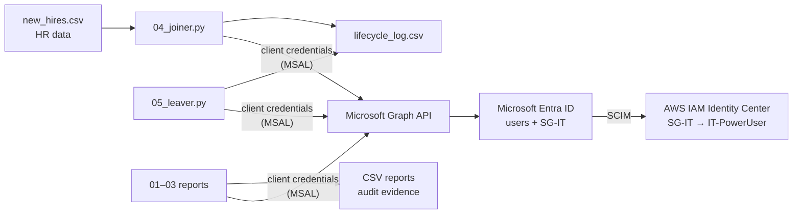

The scripts sign in as their **own application identity**, not as a person. Every call goes through one shared helper, [`graph_auth.py`](graph_auth.py), which gets a token, shows Graph's real error message when a call fails, and follows `@odata.nextLink` so results are never cut off at the first page.

---

## 1. An app identity with only the permissions it needs

I registered **Edao-IAM-Automation** as a single-tenant app with no redirect URI. It only signs in as itself, so no user ever signs in through it.

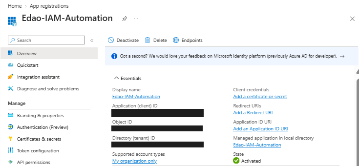

It has three **application** permissions on Microsoft Graph, each granted with admin consent:

| Permission | Why the scripts need it |
| --- | --- |
| `User.ReadWrite.All` | Read users; create joiners; disable leavers and revoke their sessions |
| `GroupMember.ReadWrite.All` | Add and remove group members |
| `AuditLog.Read.All` | Read sign-in activity and MFA registration details |

I deliberately did **not** use broader permissions like `Directory.ReadWrite.All`.

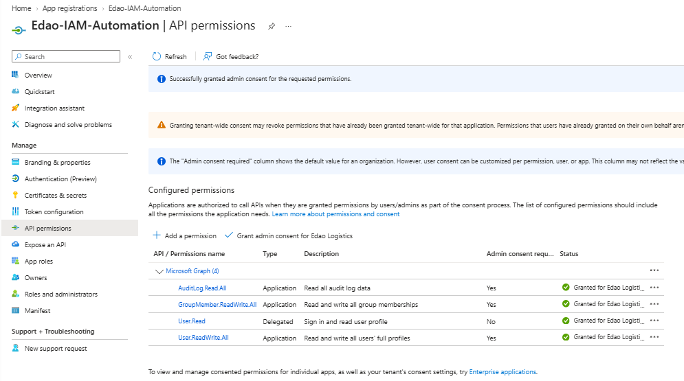

**Secrets handling:** the tenant ID, client ID and client secret live in a local `.env` file. That file is listed in [`.gitignore`](.gitignore) and was never committed. [`.env.example`](.env.example) shows the format with placeholder values. The secret was set to expire in 90 days and was deleted when the lab was finished.

## 2. Audit reports

### User inventory

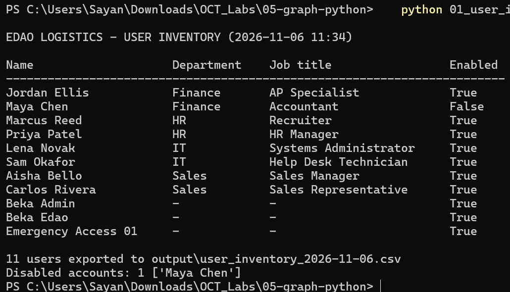

The script exports one CSV per run ([sample](sample-output/user_inventory.csv)). Two things stood out:

- **Jordan Ellis still says Department: Finance.** The [Lab 2 access review](../02-entra-id/README.md#7-access-review-catching-access-that-nobody-cleaned-up) removed his Finance group access after his transfer, but his HR attribute was never updated. Removing access and updating the record are separate steps, and only one of them happened.
- **5 users have no first or last name** (Jordan, Marcus, Priya, Aisha and Carlos; see `givenName` and `surname` in the sample CSV). That's the exact gap that broke SCIM in Lab 4. If any of them were assigned to AWS today, provisioning would fail. The inventory catches it before it causes an outage.

### Stale accounts

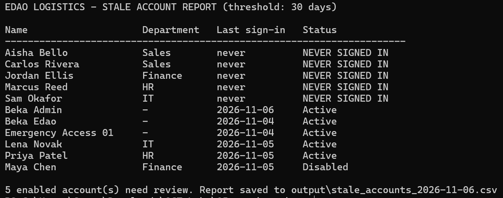

**5 enabled accounts have never signed in.** These lab accounts were created on Oct 12, so they were about 25 days old and close to the 30-day threshold. In a real tenant, unused enabled accounts are a favorite target, because nobody would notice them being misused.

The most important row is **Sam Okafor (IT)**. He has never signed in, yet Lab 4 provisioned him into AWS with **PowerUser** access. That's dormant cloud access with real permissions, and it should be the first item in the next access review. Disabled accounts like Maya's are reported separately rather than flagged.

The threshold is a parameter: `python 02_stale_accounts.py 7`.

### MFA registration

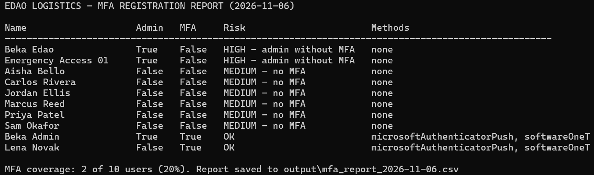

**MFA coverage is 20%** (2 of 10 users). Why:

- My Lab 2 policy requiring MFA for all users is still in **report-only** mode. It logs what it would do but forces no one to register. Priya signed in during Lab 4 without ever setting up MFA. **Before switching the policy on, the organization would need an MFA registration campaign**, or most users would be locked out.
- **Beka Edao (admin, no MFA)** is the personal Microsoft account that created the tenant. It's an external (`#EXT#`) identity, so any MFA on it is managed outside Entra, and the report can't see it. An auditor would still ask for proof.
- **Emergency Access 01 (admin, no MFA)** is the break-glass account, excluded from Conditional Access by design. Current Microsoft guidance is to give break-glass accounts **phishing-resistant MFA** (a FIDO2 key or passkey) instead of no MFA.

## 3. Joiner: one CSV row to AWS access

[`new_hires.csv`](new_hires.csv) stands in for an HR system:

```
givenName,surname,department,jobTitle
Daniel,Kim,IT,Cloud Engineer
```

The joiner script creates the user with first name, last name, department, job title and usage location. It generates a random temporary password that is **never displayed or saved** and must be changed at first sign-in. Then it adds the user to `SG-<department>`.

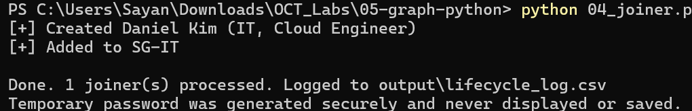

`SG-IT` is the group federated to AWS in Lab 4. I ran **Provision on demand** for Daniel. SCIM created him in AWS, and because the script sets `givenName` and `surname`, the Lab 4 `name attribute is required` error can't happen.

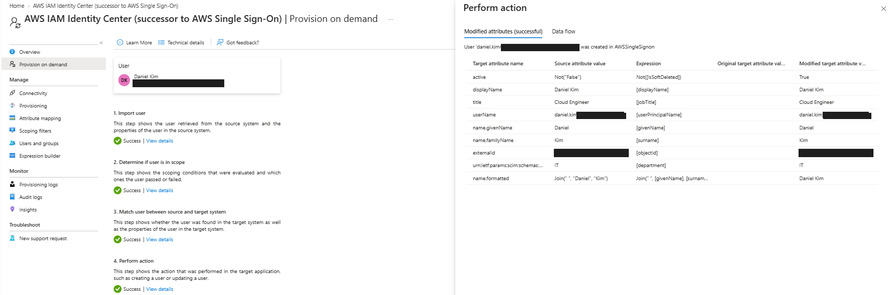

He's now in `SG-IT` in Entra and in AWS, which means he inherits the `IT-PowerUser` permission set:

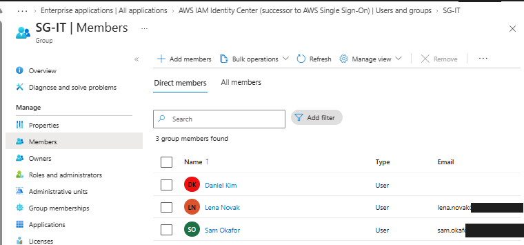
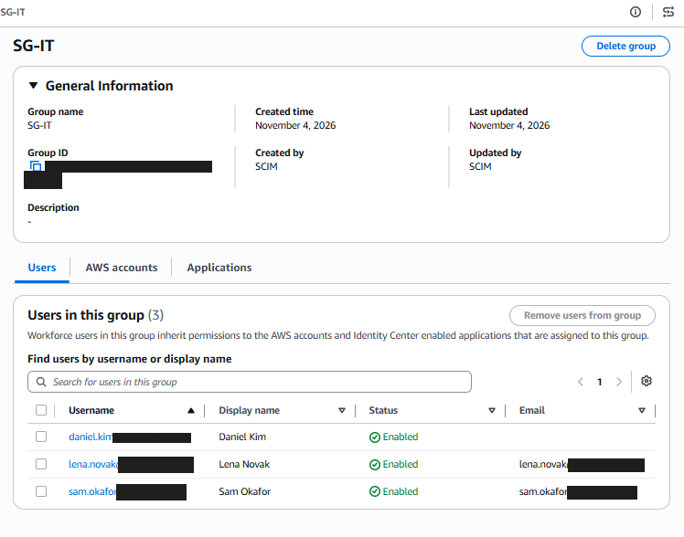

> **Python → Graph → Entra → SCIM → AWS.** One line of HR data gave a new hire cloud access, and nobody touched the AWS console.

## 4. Leaver: disable, revoke, remove, log

The leaver script takes a name, refuses to act unless **exactly one** user matches, shows the user's groups, and asks for `YES` before changing anything. Then it:

1. Disables the account (`accountEnabled = false`)
2. Revokes all sign-in sessions, which invalidates refresh tokens so existing sessions can't silently renew
3. Removes the user from every assigned group, skipping dynamic groups because their membership is rule-based
4. Appends every action to `lifecycle_log.csv`

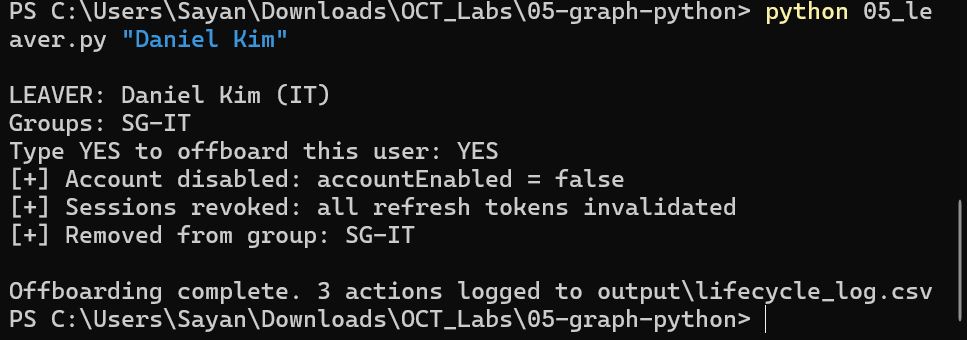

With Provision on demand, Entra flagged Daniel as **out of scope** (a blue warning, which is expected now that he's out of `SG-IT`). It still matched him in AWS and sent `active = False`:

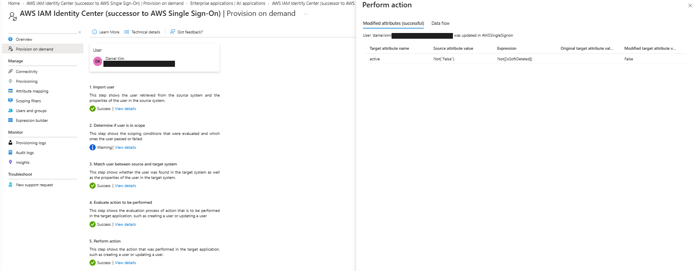

AWS now shows **two leavers, both disabled by SCIM**: Maya (Lab 4, disabled in the portal) and Daniel (Lab 5, disabled by script).

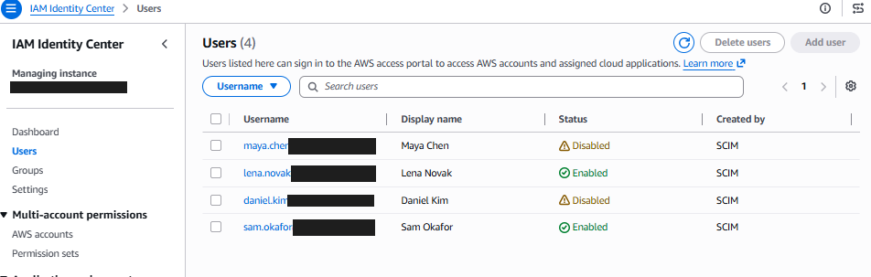

**What I noticed:** right after Provision on demand, AWS still listed Daniel in `SG-IT`, marked *Disabled*. Provisioning the user updates the **user record** right away. **Group membership** in AWS catches up on the next sync cycle (about every 40 minutes). Access was already gone, because a disabled user can't sign in, but this matters if a report is run at the wrong moment.

## Audit trail

Every change the joiner and leaver made is in [`lifecycle_log.csv`](sample-output/lifecycle_log.csv):

| Time (Nov 6, 2026) | Action | User | Detail |
| --- | --- | --- | --- |
| 11:42:06 | JOINER | Daniel Kim (IT) | Added to SG-IT |
| 15:45:07 | LEAVER – Account disabled | Daniel Kim (IT) | `accountEnabled = false` |
| 15:45:07 | LEAVER – Sessions revoked | Daniel Kim (IT) | All refresh tokens invalidated |
| 15:45:08 | LEAVER – Removed from group | Daniel Kim (IT) | SG-IT |

The same events are also recorded independently in Entra's audit log, the provisioning logs and AWS CloudTrail (see [Lab 4](../04-aws/README.md#audit-evidence)).

---

## Security decisions

- **Application identity, least privilege.** Three targeted Graph permissions instead of directory-wide write access.
- **No secrets in code or Git.** Credentials are loaded from `.env` and blocked by `.gitignore`. The secret had a 90-day expiry and was deleted after the lab.
- **Temporary passwords are never shown.** They're generated with Python's `secrets` module, and the user must change them at first sign-in.
- **Guardrails on destructive actions.** The leaver requires an exact single match and a typed `YES`, and does nothing otherwise.
- **Leaver order matters.** Disable first (stops new sign-ins), then revoke sessions (kills existing ones), then remove groups (cleans up downstream access through SCIM).
- **Fail loudly.** Any Graph error stops the script with Microsoft's actual error message instead of continuing halfway.
- **Paging handled.** `@odata.nextLink` is followed, so reports stay complete in tenants larger than one page.

## What went wrong and how I fixed it

- **`AADSTS7000215: Invalid client secret provided.`** The first run failed at sign-in. The error message said exactly what to check: Entra wants the secret's **Value**, not its **Secret ID**, and the two look similar. Copying the Value straight from Entra with the copy button and pasting it into `.env` again fixed it. The error also confirmed that the tenant ID and client ID were correct, because it named the app it had found. Only the secret was wrong.

  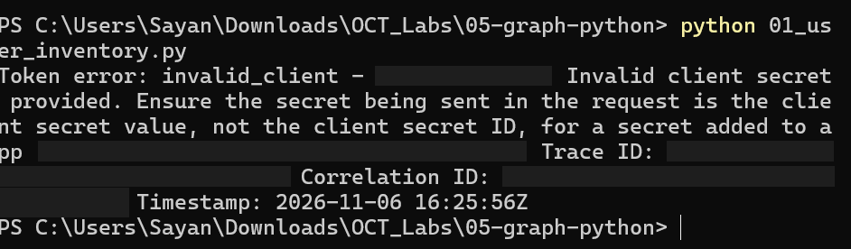

- **Making sure `.env` was really `.env`.** Notepad can quietly save files as `.env.txt`, which would make the script fail with `KeyError`. Checking with `dir -Force` before the first run confirmed the name.
- **Leaver showed a warning in Provision on demand.** At first this looked like a failure. It's expected: removing Daniel from `SG-IT` took him out of provisioning scope, which is exactly what tells Entra to disable him in AWS.

## What I'd do in production

- **Certificate or managed identity instead of a client secret.** Run the scripts in Azure Automation or Azure Functions with a managed identity, so no secret exists at all. If a secret is unavoidable, keep it in Azure Key Vault and rotate it.
- **Real HR source.** Replace the CSV with the HR system (for example, Workday through Entra's API-driven inbound provisioning), so joiners and leavers start from the system of record.
- **Temporary Access Pass** instead of a temporary password, so new hires go straight to setting up MFA.
- **A fuller leaver:** remove licenses and app role assignments, delete authentication methods, convert the mailbox, and notify the manager.
- **A dry-run mode** and **idempotency checks**. Today the joiner fails if the user already exists. It should detect that and skip.
- **Ship the logs to a SIEM** (Log Analytics or Sentinel) instead of a local CSV.
- **Tighten scope further.** Remove the unused delegated `User.Read` permission, and look at administrative units to limit which users the app can change.
- **Schedule the reports** to run weekly and feed them into the access review process in [Lab 6](../README.md).

## Skills demonstrated

Python · Microsoft Graph API (REST, OData `$select` / `$filter` / paging) · OAuth 2.0 client credentials flow (MSAL) · Entra app registrations and application permissions · Secrets management · Joiner/leaver automation · Session revocation · SCIM provisioning to AWS · Stale account and MFA coverage reporting · Audit logging · Troubleshooting Entra error codes

---

<sub>Sample CSVs in [`sample-output/`](sample-output) are the real script output with the tenant domain replaced by `edao.example`. All users are fictional.</sub>
