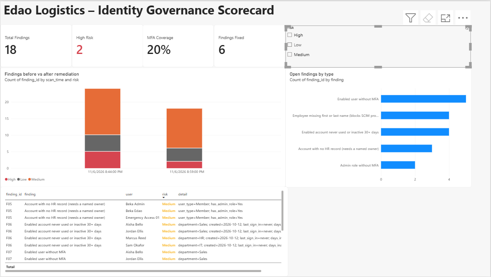
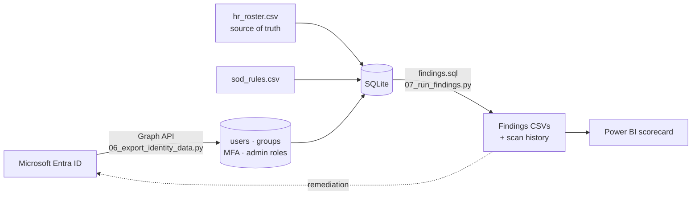
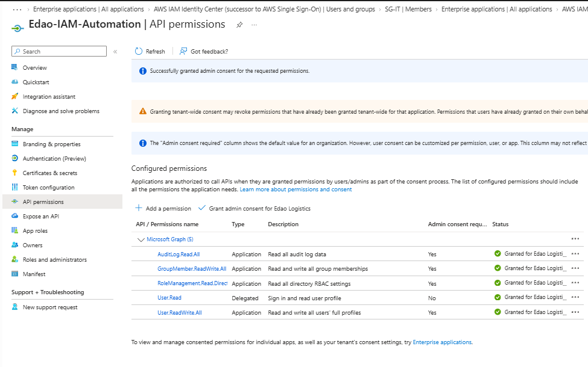
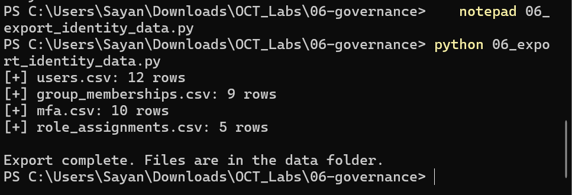
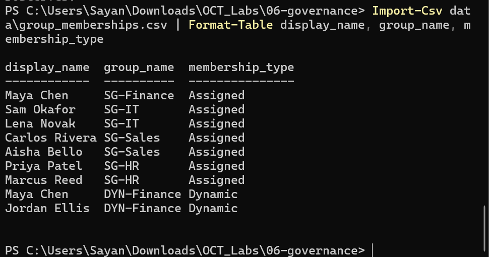
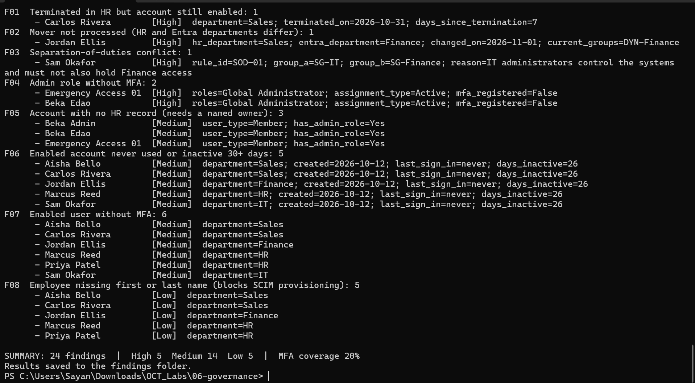
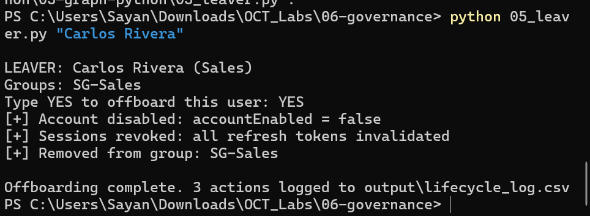
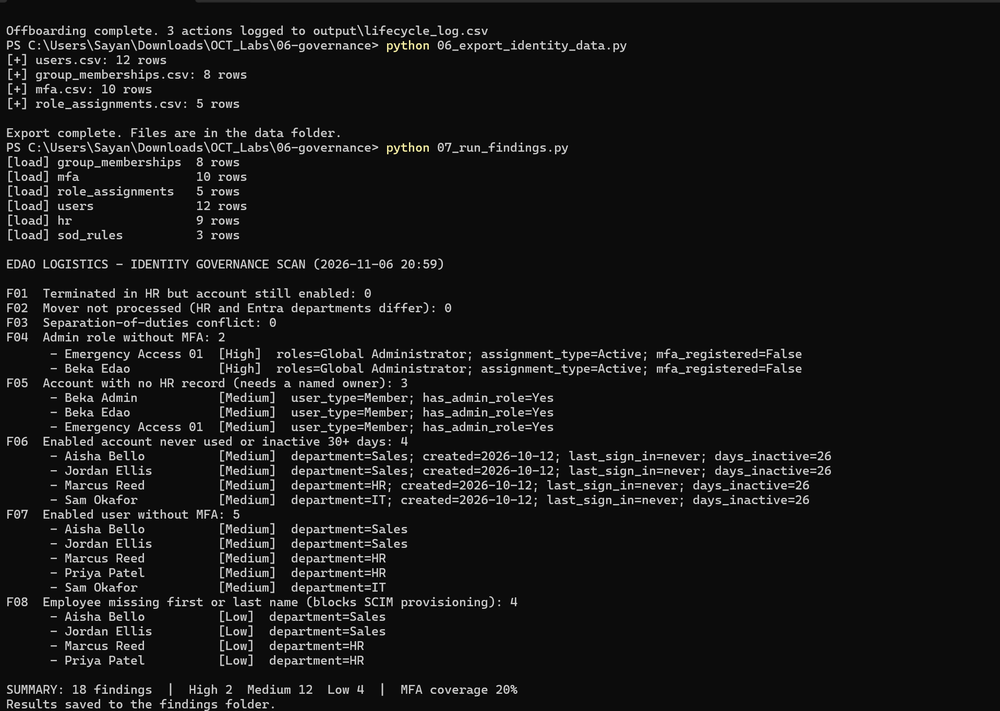
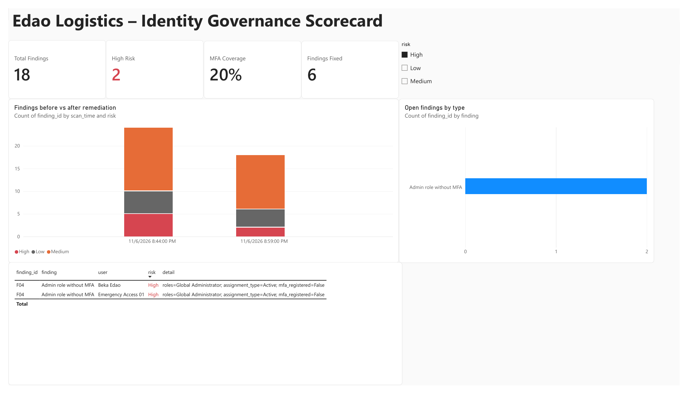
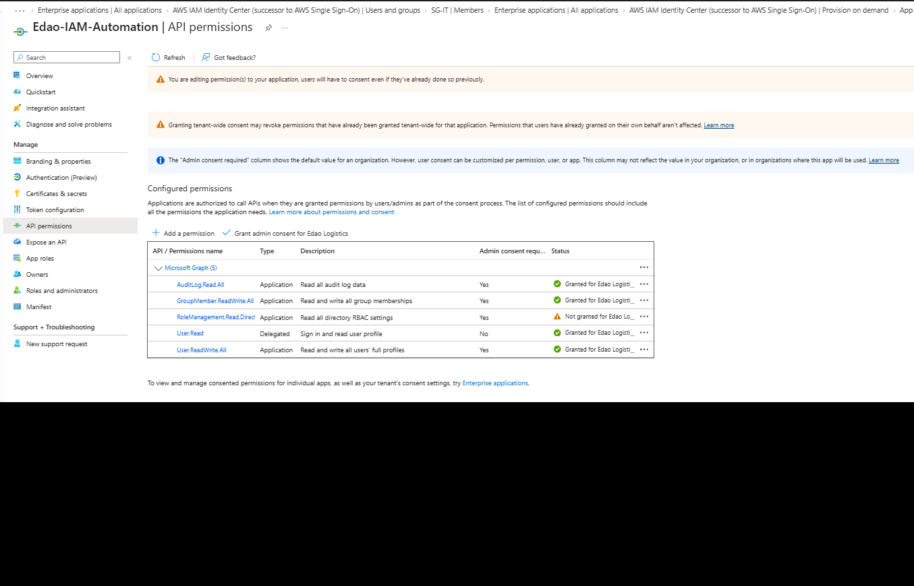

# Lab 6: Identity Governance – Access Review and Audit Evidence (SQL + Power BI)

> **Goal:** Answer the question every auditor asks an IAM team: *"Does everyone have exactly the access they should, and can you prove it?"* I exported Edao Logistics' identity data from Entra ID with Python, compared it with the HR roster using **SQL**, fixed what the scan found, scanned again, and reported the before and after in a **Power BI** scorecard.

**Platforms:** Microsoft Entra ID · Microsoft Graph API · SQLite · Power BI Desktop · **Languages:** Python, SQL, DAX · **Builds on:** [Lab 2](../02-entra-id/README.md) (Entra), [Lab 4](../04-aws/README.md) (AWS), [Lab 5](../05-graph-python/README.md) (Graph automation)

---

## Results at a glance



| | First scan (Nov 6, 20:44) | After remediation (20:59) |
| --- | --- | --- |
| **Total findings** | 24 | **18** |
| **High risk** | 5 | **2** (documented risk acceptance) |
| Terminated employee still enabled (F01) | 1 | **0** ✅ |
| Transfer not processed (F02) | 1 | **0** ✅ |
| Separation-of-duties conflict (F03) | 1 | **0** ✅ |
| MFA coverage | 20% | 20% (see [next steps](#what-id-do-in-production)) |

Every High finding was either fixed and verified by a second scan, or documented with an owner and a plan. That's the full **detect → fix → verify** cycle an audit expects.

---

## How it works



1. **Export:** one Python script pulls four datasets from Microsoft Graph: users (with last sign-in), group memberships, MFA registration and directory role assignments (both active and PIM-eligible).
2. **Compare:** a second script loads them into SQLite together with the **HR roster**, which is the source of truth for who works here and in which department, and with a table of **separation-of-duties rules**. It then runs 8 SQL checks.
3. **Remediate and re-scan:** fix the findings, then run both scripts again. Every scan is appended to a history file, so the dashboard can show the trend.
4. **Report:** Power BI reads the findings history and shows the scorecard.

---

## 1. Export identity data from Entra

The automation app from Lab 5 got one more **read-only** permission, `RoleManagement.Read.Directory`, so the export can list who holds admin roles. I added it with admin consent and a fresh 90-day client secret.



[`06_export_identity_data.py`](06_export_identity_data.py) writes four CSVs:



| File | Contents |
| --- | --- |
| `users.csv` | Name, department, title, enabled status, user type, created date, **last sign-in** |
| `group_memberships.csv` | Every user-to-group membership, marked **Assigned** or **Dynamic** |
| `mfa.csv` | MFA registration and methods per user, plus admin flag |
| `role_assignments.csv` | Directory roles, both **Active** and **Eligible (PIM)** |



[`sample-data/`](sample-data) holds this export with the object IDs and tenant domain replaced. The real `data/` folder is in `.gitignore`.

## 2. The source of truth: HR roster and SoD rules

[`hr_roster.csv`](hr_roster.csv) is a simulated HR export. It reflects what happened in earlier labs, plus one new scenario:

| Employee | HR says | Why it matters |
| --- | --- | --- |
| Maya Chen | Terminated Nov 4 | Disabled in Lab 4. Should be clean |
| Daniel Kim | Terminated Nov 6 | Disabled by the Lab 5 leaver script. Should be clean |
| Jordan Ellis | **Moved to Sales** Nov 1 | Entra still says Finance |
| **Carlos Rivera** | **Terminated Oct 31** | New scenario: HR never told IT |

[`sod_rules.csv`](sod_rules.csv) defines toxic combinations of access. `%Finance` matches both `SG-Finance` and the dynamic `DYN-Finance` group:

| Rule | Combination | Risk | Why |
| --- | --- | --- | --- |
| SOD-01 | SG-IT + any Finance group | High | IT controls the systems and must not also hold Finance access |
| SOD-02 | SG-HR + any Finance group | High | HR changes employee and pay records |
| SOD-03 | SG-Sales + any Finance group | Medium | Sales negotiates deals and must not also approve payments |

To prove the SoD check works, I **planted one conflict**: I added Sam Okafor (IT) to `SG-Finance`.

## 3. The SQL checks

All 8 checks are in [`findings.sql`](findings.sql), and [`07_run_findings.py`](07_run_findings.py) runs them in order:

| ID | Check | Risk | Key SQL technique |
| --- | --- | --- | --- |
| F01 | Terminated in HR, account still enabled | High | `JOIN` HR ↔ users on status |
| F02 | Mover not processed (HR and Entra departments differ) | High | Join with a correlated subquery listing current groups |
| F03 | Separation-of-duties conflict | High | Self-join on memberships, `LIKE` pattern rules |
| F04 | Admin role without MFA | High | `LEFT JOIN` roles ↔ MFA, `GROUP BY` |
| F05 | Account with no HR record (needs a named owner) | Medium | Anti-join (`LEFT JOIN … IS NULL`) |
| F06 | Enabled account never used or inactive 30+ days | Medium | Date math with `julianday()` |
| F07 | Enabled user without MFA | Medium | Join with filters |
| F08 | Employee missing first or last name (breaks SCIM to AWS) | Low | Data-quality check |

Example: the SoD check matches every membership against every rule, then looks for the same user in the conflicting group:

```sql
SELECT s.rule_id, a.display_name, a.group_name AS group_a, b.group_name AS group_b, s.risk
FROM sod_rules s
JOIN group_memberships a ON a.group_name LIKE s.group_a
JOIN group_memberships b ON b.user_id = a.user_id
                        AND b.group_name LIKE s.group_b
                        AND b.group_name <> a.group_name
JOIN users u ON u.user_id = a.user_id AND u.account_enabled = 'True';
```

### First scan: 24 findings, 5 High



| Finding | What the SQL found |
| --- | --- |
| 🔴 **F01: Carlos Rivera** | Terminated 7 days earlier, account still enabled. A former employee could still sign in. |
| 🔴 **F02: Jordan Ellis** | HR says Sales, Entra still says Finance, and he's still in **`DYN-Finance`**. See below. |
| 🔴 **F03: Sam Okafor** | IT plus Finance access, breaking rule SOD-01 (the planted conflict). |
| 🔴 **F04: two Global Administrators without MFA** | The tenant-owner account and the break-glass account. |
| 🟡 F05–F07 | 3 admin accounts with no HR owner, 5 enabled accounts never used, 6 users without MFA. |
| 🟢 F08 | 5 employees with no first or last name, the gap that broke SCIM in Lab 4. |

**The finding I didn't plan: access the review couldn't see.** In Lab 2, an access review removed Jordan from `SG-Finance` after his transfer. But `DYN-Finance` adds anyone whose **department attribute** equals Finance, and nobody updated his department. The review removed one path to Finance access, while the dynamic group quietly kept the other one open. Only a comparison against HR data catches this, because every group still looks correctly configured on its own.

## 4. Remediation

| Finding | Fix | How |
| --- | --- | --- |
| F01 Carlos | Offboarded | Reused my **Lab 5 leaver script**: disabled the account, revoked sessions, removed groups, logged each action |
| F02 Jordan | Processed the move | Set department to **Sales** and title to Sales Representative, added him to `SG-Sales`. Entra then **removed him from `DYN-Finance` automatically** |
| F03 Sam | Removed the conflict | Removed him from `SG-Finance` |
| F04 Admins | **Risk accepted and documented** | See below |



The leaver's actions are in [`evidence/lifecycle_log.csv`](evidence/lifecycle_log.csv):

| Time (Nov 6, 2026) | Action | User |
| --- | --- | --- |
| 20:46:31 | Account disabled (`accountEnabled = false`) | Carlos Rivera |
| 20:46:31 | Sessions revoked (all refresh tokens invalidated) | Carlos Rivera |
| 20:46:32 | Removed from SG-Sales | Carlos Rivera |

**F04 risk acceptance.** Not every finding can be fixed the same day. Real audits allow a documented exception with an owner and a plan:

| Account | Why it can't be fixed today | Compensating control | Plan |
| --- | --- | --- | --- |
| Beka Edao (tenant owner) | External personal Microsoft account. Its MFA is managed outside Entra, so the report can't see it | Not used for daily work: admin tasks run from the separate **Beka Admin** account, which has MFA registered | Remove Global Administrator from this account once the dedicated admin and break-glass accounts are proven |
| Emergency Access 01 | Break-glass account, excluded from Conditional Access by design | Long, separately stored password; used only in emergencies | Register a **FIDO2 security key** (phishing-resistant MFA, per current Microsoft guidance), and alert on every sign-in |

## 5. Verify: second scan



F01, F02 and F03 dropped to **0**. Group memberships went from 10 to 8 rows: Carlos left `SG-Sales`, Sam left `SG-Finance`, and Jordan left `DYN-Finance` while joining `SG-Sales`. Every change is accounted for. Both scans are stored in [`findings/findings_history.csv`](findings/findings_history.csv) and [`findings/summary_history.csv`](findings/summary_history.csv).

## 6. Power BI scorecard

[`edao_governance_dashboard.pbix`](edao_governance_dashboard.pbix) (a [PDF export](edao_governance_dashboard.pdf) is included for viewing on GitHub) reads the findings CSVs:

- **KPI cards** use DAX measures that always show the **latest** scan:
  ```
  High Risk =
  VAR latest = MAX(summary_history[scan_time])
  RETURN CALCULATE(SUM(summary_history[high]), summary_history[scan_time] = latest)

  Findings Fixed =
  VAR first  = MIN(summary_history[scan_time])
  VAR latest = MAX(summary_history[scan_time])
  RETURN CALCULATE(SUM(summary_history[total_findings]), summary_history[scan_time] = first)
       - CALCULATE(SUM(summary_history[total_findings]), summary_history[scan_time] = latest)
  ```
- **Before vs after** stacked columns from the scan history, colored by risk
- **Open findings by type**, so the biggest remaining gap stands out (users without MFA)
- **Findings table** with risk colored by a DAX measure (`Risk Color`), plus a **risk slicer**

Filtering to **High** shows that only the two accepted-risk admin findings remain:



---

## Security decisions

- **Read-only where possible.** The only new permission is `RoleManagement.Read.Directory`. The app's write permissions were used solely through the existing leaver script, with its `YES` confirmation.
- **HR is the source of truth**, not the directory. A directory that agrees with itself can still be wrong.
- **Fix the attribute, not just the group.** For Jordan, correcting the department was the real fix. The dynamic group followed automatically.
- **No secrets or identifiers in Git.** `.env`, raw exports and the SQLite database are in `.gitignore`. The published sample data has object IDs replaced and the tenant domain changed to `edao.example`.
- **Repeatable evidence.** Each scan is timestamped and appended to a history file instead of being overwritten.

## What went wrong and how I fixed it

- **Permission added but not granted.** After adding `RoleManagement.Read.Directory`, the status column showed an orange *"Not granted for Edao Logistics"*. Adding a permission doesn't make it usable; **admin consent** has to be granted for application permissions. Clicking *Grant admin consent* fixed it.

  

- **Script not found.** My first run failed with `No such file or directory` because I'd skipped creating the export script. `dir -Force` before running is now a habit.
- **Conditional formatting on the wrong column.** In Power BI, the risk color was first applied to the **detail** column. Removing it there and applying the `Risk Color` measure to **risk** (values only) fixed it.
- **Power BI split timestamps into year, quarter and month.** Setting `scan_time` to **Text** kept each scan as one column in the chart.

## What I'd do in production

- **Match on `employeeId`, not display name.** Names aren't unique. Populate `employeeId` in Entra from HR and join on it.
- **Pull HR data automatically** from the HR system (for example Workday) instead of a CSV.
- **Run the scan on a schedule** (Azure Automation or GitHub Actions) and publish the report to the Power BI service with scheduled refresh.
- **Tickets for findings.** Open a ticket for each High finding with an owner and due date, and track time to remediate.
- **Fix MFA coverage at scale:** run a registration campaign with Temporary Access Passes, then switch the Lab 2 Conditional Access policy from report-only to **On**.
- **Clean up disabled accounts on a schedule.** Delete disabled leavers after a retention period (for example 30 days), so the directory doesn't fill with stale objects.
- **Add more SoD rules** for admin roles (for example, no one should hold both User Administrator and a Finance group) and for AWS permission sets.

## Files

| File | Purpose |
| --- | --- |
| [`06_export_identity_data.py`](06_export_identity_data.py) | Exports users, groups, MFA and admin roles from Microsoft Graph |
| [`07_run_findings.py`](07_run_findings.py) | Loads the CSVs into SQLite, runs `findings.sql`, writes findings and history |
| [`findings.sql`](findings.sql) | The 8 governance checks |
| [`hr_roster.csv`](hr_roster.csv), [`sod_rules.csv`](sod_rules.csv) | Source of truth and SoD policy |
| [`05_leaver.py`](05_leaver.py), [`graph_auth.py`](graph_auth.py) | Reused from [Lab 5](../05-graph-python/README.md) |
| [`sample-data/`](sample-data) | Sanitized export (copy to `data/` to run the scan without Entra) |
| [`findings/`](findings) | Scan results and history from both scans |
| [`evidence/lifecycle_log.csv`](evidence/lifecycle_log.csv) | Leaver actions for Carlos Rivera |
| [`edao_governance_dashboard.pbix`](edao_governance_dashboard.pbix) / [`.pdf`](edao_governance_dashboard.pdf) | Power BI scorecard |

**Try it without a tenant:** copy `sample-data` to `data`, then run `python 07_run_findings.py`. You'll get the after-remediation scan (18 findings).

## Skills demonstrated

Identity governance · Access certification evidence · Separation of duties · Joiner/mover/leaver reconciliation against HR · SQL (joins, anti-joins, self-joins, correlated subqueries, date math) · SQLite · Python · Microsoft Graph API · Power BI · DAX · Data visualization · Risk acceptance and remediation tracking · Audit trail design
