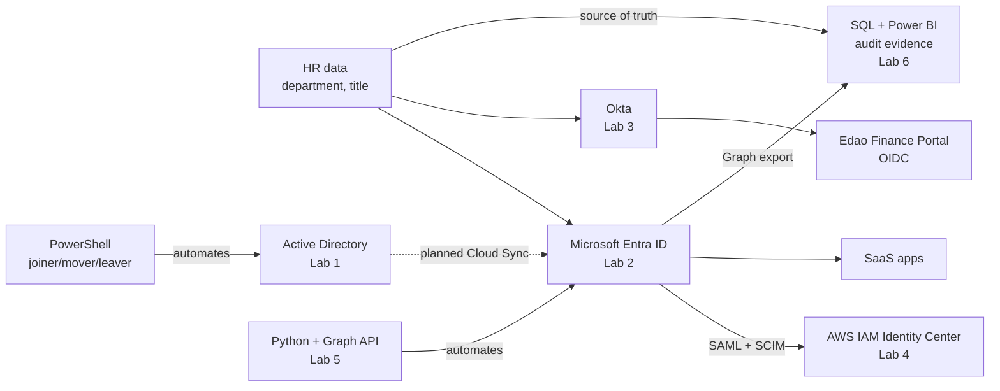

# IAM Home Lab

**Hands-on identity and access management labs, built and documented end to end.**

I'm designing the identity program for **Edao Logistics**, a fictional company, across the platforms real IAM teams run every day: Microsoft Entra ID, Okta, Active Directory and AWS. Every lab is built from scratch, tested against expected outcomes, and backed by screenshots and audit-log evidence.

---

## Labs

| # | Lab | What it proves | Status |
| --- | --- | --- | --- |
| 01 | [**Active Directory + PowerShell joiner/mover/leaver**](01-active-directory/README.md) | Domain controller build, OU and group design, scripted lifecycle with audit log | ✅ Complete |
| 02 | [**Microsoft Entra ID: Zero Trust access**](02-entra-id/README.md) | Conditional Access, MFA, PIM just-in-time admin, dynamic groups, access reviews | ✅ Complete |
| 03 | [**Okta: SSO and lifecycle**](03-okta/README.md) | OIDC SSO, phishing-resistant MFA, automated joiner/mover/leaver | ✅ Complete |
| 04 | [**AWS IAM Identity Center federated to Entra ID**](04-aws/README.md) | Cloud federation (SAML + SCIM), least-privilege permission sets, cross-cloud leaver | ✅ Complete |
| 05 | [**Python automation with Microsoft Graph**](05-graph-python/README.md) | Identity audits and joiner/leaver automation through APIs, end to end into AWS | ✅ Complete |
| 06 | [**Identity governance: audit evidence with SQL + Power BI**](06-governance/README.md) | HR-vs-directory reconciliation, SoD conflicts, remediation verified by re-scan | ✅ Complete |

## Highlights

- **On-premises foundation:** built a Windows Server 2025 domain controller from scratch, with OUs and department groups created by script and PowerShell joiner/mover/leaver that removes old access *before* granting new access.
- **Zero Trust in Entra ID:** 3 Conditional Access policies validated in report-only mode against real sign-ins and the What If tool before enforcement. A break-glass account is excluded from all of them.
- **No standing admin rights:** PIM makes admin roles *eligible*, with justification, approval and a 2-hour limit. Every step lands in the audit log.
- **Attribute-driven lifecycle in Okta:** one department change moves a user between access groups and **revokes old app access automatically**. A departing employee loses app access, sessions and sign-in in the same second.
- **One identity, every cloud:** Entra ID federates to AWS with SAML and provisions users with SCIM. Disabling a user in Entra disabled them in AWS, with `PatchUser` and `DisableUser` events as proof in CloudTrail.
- **Governance that carries through:** a quarterly access review removed a transferred employee's leftover Finance access, so he was never provisioned into AWS at all.
- **Identity as code:** Python scripts on the Microsoft Graph API audit stale accounts and MFA coverage (20% at first scan) and run joiner/leaver end to end. One CSV row onboarded a new hire all the way into AWS.
- **Audit evidence, not just configuration:** 8 SQL checks compare Entra against the HR roster. The first scan found 24 issues (5 High, including a terminated employee who could still sign in). After remediation, a second scan proved High findings dropped to 2, both with a documented risk acceptance, all shown in a Power BI scorecard.
- **Token-level verification:** decoded OIDC ID tokens to confirm *how* users authenticated, including phishing-resistant authentication (`amr: phr`).
- **Real troubleshooting:** each lab documents what broke and how I found the root cause. One example: a misconfigured group rule that only surfaced during a mover test.

## Architecture

*Solid lines are built. The dotted line (AD → Entra with Cloud Sync) is the next planned extension.*

## Skills demonstrated

| Area | Skills |
| --- | --- |
| Identity providers | Active Directory Domain Services, Microsoft Entra ID, Okta Workforce Identity, AWS IAM Identity Center |
| Authentication | MFA, phishing-resistant MFA (Okta Verify FastPass), Conditional Access, authentication policies |
| Authorization | RBAC, attribute-based group assignment, least privilege, AWS permission sets |
| Privileged access | PIM: eligible roles, approval workflows, time-bound activation, break-glass accounts |
| Lifecycle | Joiner / mover / leaver (PowerShell, Okta, Graph), OU design, dynamic groups, Okta group rules, SCIM provisioning, deactivation vs. suspension |
| Federation and protocols | SAML 2.0, OpenID Connect, SCIM 2.0, JWT / ID token analysis |
| Automation | PowerShell (ActiveDirectory module), Python, Microsoft Graph API, OAuth 2.0 client credentials (MSAL), secrets management |
| Governance | Access reviews, separation of duties, HR reconciliation, risk acceptance, SQL, Power BI and DAX reporting, stale account and MFA coverage reporting, sign-in logs, audit logs, Okta System Log, Entra provisioning logs, AWS CloudTrail, evidence collection |

## About me

**Beka Edao** · Management Information Systems (B.S., 2026) · CompTIA Security+

I'm an entry-level IAM analyst building practical experience in identity, cloud and security. My background in SQL and Power BI reporting means I can do the part of IAM that's easy to skip: proving access is correct with clean audit evidence.

Open to **IAM Analyst**, **Identity Governance** and **Access Management** roles in the Washington, DC area or remote. Eligible for U.S. security clearance.

<!-- Add your LinkedIn URL here: [LinkedIn](https://www.linkedin.com/in/your-profile) -->

---

All users, companies and data in these labs are fictional. Tenant IDs, tokens, client IDs and IP addresses are redacted from every screenshot.
